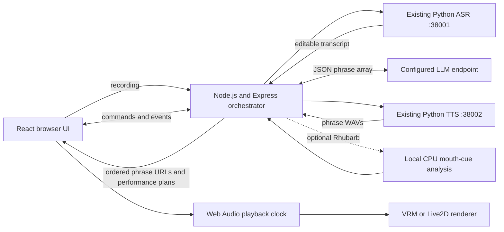

# Digital Human Chatbot — implementation suggestions

Date: 13 October 2026. Status: proposed implementation; application code has not been built.

## Recommended direction

Implement this directory as a **React + TypeScript + Vite frontend and a Node.js + Express + TypeScript orchestration backend**, reusing the existing ASR and TTS HTTP services. Start with the downloaded **Constraint Twist VRM** and add **Haru/Ren Live2D** through a small renderer interface after the first complete conversational flow works.

The application backend uses Express. The available Python/FastAPI speech services remain independent MLX workers, called over HTTP; they do not need to be rewritten in Node. Their code, configuration, request/response contracts and current reachability are studied in [SERVICE_INTEGRATION.md](SERVICE_INTEGRATION.md).

The inputs are [INSIGHTS.md](../../../docs/v1/INSIGHTS.md), [PLAN.md](../../../docs/v1/PLAN.md), the [persona research](../../../docs/v1/personas/README.md), and the implemented [speech service contracts](../services/README.md). Your confirmed preferences are local execution, free sample assets, stylized 3D and Live2D, and English/Mandarin/Cantonese.

`INSIGHTS.md` supports the ASR → LLM → TTS → facial-animation product flow. It does not establish an installable version of Asiabots' proprietary renderer. Build our own implementation of that flow.

`PLAN.md` already provides useful UI, service, session and cancellation requirements. Its opening implementation decision now identifies Express and the local avatar direction; its older photorealistic/MuseTalk sections remain background. This document provides the current implementation proposal.

The target directory has configuration and design documents, with no application runtime yet. Its `.env` and `.env.example` contain the three LLM setting names and the selected ASR/TTS base URLs on ports 38001/38002. Retain the existing LLM values when implementation begins. The old `poc_digital_human_chatbot_any` directory is absent in the current workspace; use this directory as the application root.

## Architecture and stack



| Layer | Suggested implementation | Reason |
| --- | --- | --- |
| Frontend | React, TypeScript, Vite, ordinary CSS | Implements the mockup composition, recording controls, conversation and avatar canvas. |
| Application API | Node.js 24 LTS, Express 5, TypeScript, Zod, native `fetch` | Typed orchestration, validated configuration and HTTP service clients. Node v24.18.0 is already installed locally. |
| Events/control | `ws` attached to the Node HTTP server; HTTP for uploads and media | Text deltas, processing state, Stop/Reset and playback acknowledgements use one channel. |
| Recording uploads | Route-scoped Multer with file/count/field limits | Parse browser multipart recordings before forwarding them using native `FormData`. |
| Default avatar | Three.js + `@pixiv/three-vrm` | Existing sample models expose named vowel, blink and emotion expressions. |
| Illustrated avatar | Official Cubism Web SDK/Core behind a Live2D adapter | Reuses the speech/playback flow with the downloaded model packages. |
| Mouth animation | Browser RMS amplitude by default; optional Rhubarb subprocess | Starts with the available WAV immediately; Rhubarb adds phonetic categories when selected. |
| Playback | Web Audio, queued sources on one audio clock | Schedules phrases in order and synchronizes mouth, gestures, pause and replay. |
| Storage | Bounded in-memory sessions and expiring media files | Appropriate for the initial single-user local application. |

Use the M1 Max's integrated graphics for browser rendering. No separate CUDA worker is required by this design. Performance under simultaneous speech inference still needs measurement. The LLM endpoint's location remains independently configurable; strict offline operation also requires a local LLM and locally cached dependencies.

The diagram uses the currently configured speech ports, **38001/38002**. Their code/example defaults are 8001/8002. The Express client must use explicit `ASR_BASE_URL` and `TTS_BASE_URL` values matching the running service configuration.

Official implementation references: [Node release support](https://nodejs.org/en/about/previous-releases), [Express 5](https://expressjs.com/en/guide/migrating-5/), [Node fetch/FormData/AbortSignal](https://nodejs.org/api/globals.html), [ws server integration](https://github.com/websockets/ws), [Multer uploads](https://expressjs.com/en/resources/middleware/multer/), [three-vrm loading examples](https://github.com/pixiv/three-vrm), [Cubism lip-sync manual](https://docs.live2d.com/en/cubism-sdk-manual/lipsync/), [Rhubarb recognizers and cue format](https://github.com/DanielSWolf/rhubarb-lip-sync).

## Suggested directory layout

```text
digital_human_chatbot_any/
├── .env                         # existing backend settings
├── .env.example                 # documented placeholders/defaults
├── .gitignore
├── IMPLEMENTATION.md
├── SERVICE_INTEGRATION.md        # inspected ASR/TTS contracts and Node adapters
├── README.md                    # actual setup and limitations once built
├── package.json                 # npm workspaces and coordinated dev/build commands
├── personas.json                # identity, asset, renderer, voice mapping, credits
├── backend/
│   ├── package.json
│   ├── tsconfig.json
│   ├── src/
│   │   ├── server.ts            # HTTP server, ws upgrades, shutdown
│   │   ├── app.ts               # Express routes, uploads, static/media, errors
│   │   ├── config.ts            # application-root .env, validation, env overrides
│   │   ├── sessions.ts          # history, active turn, expiry
│   │   ├── pipeline.ts          # one turn's LLM → TTS → cues lifecycle
│   │   ├── media.ts             # opaque media IDs, cleanup, session association
│   │   └── services/
│   │       ├── http.ts          # shared timeout, cancellation and error handling
│   │       ├── llm.ts           # compatible chat-completions endpoint adapter
│   │       ├── asr.ts           # multipart fetch client and transcript validation
│   │       ├── tts.ts           # JSON fetch client and binary WAV handling
│   │       └── lipsync.ts       # async Rhubarb spawn and neutral cue conversion
│   └── tests/                  # lifecycle, provider boundaries, media expiry
├── shared/
│   ├── package.json            # workspace exports for schemas/types
│   └── protocol.ts             # shared request/event schemas and inferred types
├── frontend/
│   ├── package.json
│   ├── vite.config.ts          # development /api and WebSocket proxy
│   ├── public/personas/        # selected assets + required notices, staged locally
│   └── src/
│       ├── App.tsx
│       ├── components/         # AvatarPanel, ChatPanel, Composer, Controls
│       ├── session/            # typed events and UI state reducer
│       ├── audio/              # recording, playback, cue scheduling
│       └── avatars/
│           ├── types.ts        # renderer interface and neutral mouth pose
│           ├── VrmRenderer.ts
│           └── Live2DRenderer.ts
├── scripts/
│   ├── stage-personas.ts       # copy selected verified packages and notices
│   ├── check-services.ts       # configuration and readiness checks
│   └── benchmark.ts            # reproducible turn/stage timing
└── runtime/                   # ignored temporary recordings, WAVs and cues
```

Create files as their milestone needs them. Keep MLX model loading in the existing speech processes. Use npm workspaces, `tsx` for development, and TypeScript compilation for the production Node process; run one backend process while session state is in memory. Put protocol schemas/types in a shared package, and validate runtime messages at both boundaries. Bundle frontend libraries locally and lock dependency versions during implementation.

The current downloaded collection remains the source for staging assets. Copy selected runtime packages with their manifest and applicable notices; retain the Live2D relative file structure. Do not expose the repository root as a static directory. A setup command should stage assets reproducibly rather than requiring manual copying.

## API and event contract

| Interface | Responsibility |
| --- | --- |
| `GET /api/health` | Report application readiness, service ready/busy state, configuration presence and lip-sync executable availability. Report upstream reachability separately from configuration. |
| `GET /api/personas` | List available avatars, renderer capability, credits and per-language speech status; no secret settings. |
| `POST /api/sessions` | Create a bounded, expiring session. |
| `POST /api/sessions/{id}/transcribe` | Accept recording and forward to ASR with `align=false`; return transcript for editing. |
| `WS /api/sessions/{id}/events` | Receive commands and stream typed answer/state/media events. |
| `GET /api/sessions/{id}/media/{media_id}` | Serve session-associated temporary audio using an opaque identifier. |

Suggested command types: `turn.send`, `turn.stop`, `session.reset`, `playback.started`, `playback.ended`, `playback.failed`. Capture persona and language when accepting a turn; changing the selector affects subsequent turns.

Suggested server event types: `turn.started`, `state.changed`, `answer.delta`, `answer.final`, `speech.ready`, `turn.interrupted`, `turn.completed`, `error`. Include `session_id`, `turn_id` and a monotonically increasing session event sequence. The backend reports speech readiness; browser playback callbacks determine when speaking actually starts and ends.

Example `speech.ready` payload:

```json
{
  "type": "speech.ready",
  "session_id": "opaque-session-id",
  "turn_id": "opaque-turn-id",
  "seq": 18,
  "audio_url": "/api/sessions/opaque-session-id/media/opaque-media-id",
  "duration_seconds": 4.2,
  "persona_id": "constraint-twist",
  "language": "en",
  "lip_sync": {
    "method": "rhubarb",
    "cues": [{"start": 0.0, "end": 0.1, "shape": "rest"}]
  }
}
```

Values and cues above are illustrative. Transmit audio as an ordinary media response; JSON carries metadata/cues. Keep all provider response parsing inside adapters. “Any LLM” means the configured compatible API or an explicitly added provider adapter.

## Turn orchestration and cancellation

1. Start an explicit browser session to enable audio. Load the default avatar once and report actual component readiness.
2. Typed input can be sent immediately. For voice input, use `MediaRecorder` with a browser-supported MIME type, upload the recording, and let the user edit the returned transcript before sending.
3. Accept one active turn per session. Bound input/history and stream only user-visible assistant content from the LLM. Reasoning/tool fields must not become spoken text.
4. Store the completed textual answer when text generation finishes. Keep playback status separate, so a speech failure does not lose a valid answer. Exclude unfinished interrupted assistant text from subsequent LLM context while retaining a visible interrupted message.
5. Frame complete JSON phrase objects from provider deltas, repair syntax if needed, and validate before exposing text or controls. Synthesize phrases sequentially through the persistent TTS service, starting before LLM completion when a phrase is ready. Respect real sample rates and declared limits.
6. Emit `speech.ready` for each phrase with its index, clean text, performance plan, and media URL. Amplitude mode needs no analysis; optional Rhubarb analyzes each phrase WAV. Emit `speech.queue.finished` after production completes, and retain the turn until the browser finishes all audio.
7. Decode/play through Web Audio. Amplitude mode reads short waveform windows with an `AnalyserNode` before the mute gain, gates silence, and smooths RMS into continuous mouth opening. Rhubarb mode samples cues against the audio clock. Both modes close on pause/Stop/completion; blink/gaze remain separate idle controls.
8. Finish on actual browser playback completion. Return to idle and release mouth weights. Treat playback failure explicitly and offer retry or a labeled audio-only path.

**WebSocket message handling must stay responsive while a turn runs.** Track the active pipeline Promise and an `AbortController` for each turn; dispatch long work without blocking command handling. Serialize command/state mutations, serialize outbound events, bound queues, and abort/invalidate the active turn on Stop, Reset or connection loss. Express error middleware does not catch detached Promise or `ws` handler failures; handle those errors explicitly.

On Stop, the browser stops its audio source immediately and clears scheduled mouth motion before waiting for the backend. Both sides discard stale turn IDs. Reset also clears history and advances the session generation so obsolete results cannot reappear.

Stopping an HTTP request does not stop the existing speech services' Metal inference. They retain their inference slot until completion. Display real busy state and use bounded retry only while the requesting turn remains valid. Compose turn cancellation and stage timeouts using `AbortSignal`, and retain the timeout through response-body consumption. Run Rhubarb with asynchronous `child_process.spawn`, an argument list, a timeout and subprocess cleanup; avoid `spawnSync`, `execSync` and blocking media operations in request handlers.

## Persona and lip-sync choices

The first renderer should load **Constraint Twist** with `GLTFLoader` and `VRMLoaderPlugin`, apply an appropriate idle pose, and animate the registered vowel expressions `aa`, `ih`, `ou`, `ee`, `oh`. Its underlying model has additional face targets; use standard expressions first for compatibility with Seed-san.

Use a renderer interface such as `load`, `applyMouthPose`, `setEmotion`, `update`, `dispose`. Let the central playback controller own audio. A renderer should receive mouth poses rather than independently playing a voice or generating a second timeline.

Rhubarb's English recognizer and non-English `phonetic` recognizer provide initial timed categories. Map them to neutral categories such as closed, wide, narrow and rounded, then translate those into each avatar's available controls. Smooth transitions and reset speech targets on silence. This is an approximation requiring visual evaluation.

For Live2D, the acquired Haru/Ren models declare mouth opening and mouth form; these offer less articulatory detail than a full speech rig. Obtain official Cubism Core/Web dependencies when adding that adapter. Live2D mouth form should not be treated as a standardized vowel selector. Detailed consonant shaping may require a custom rig or the extra MPFB GLB sample.

Amplitude-driven mouth opening is the default for conversational latency. It drives Live2D `ParamMouthOpenY` and VRM `aa` directly without a Rhubarb subprocess or precomputed cues. It follows voice intensity and silence, but does not recognize phonemes or distinguish vowel shapes. Rhubarb remains selectable for phonetic categories. HeadAudio is a later browser-side experiment; its Mandarin/Cantonese behavior remains unverified.

Talking performance follows actual browser playback. The LLM returns an array of
`{"phrase":"Hello!","emotion":"happy","gestures":[{"name":"wave","strength":0.4}]}`
objects. Emotion and gestures apply to that object's phrase. Supported gestures
are `nod`, `shake_head`, `wave`, `open_hand`, and `shrug`, plus the seven VRM pose
presets described below. The prompt asks for
sparse gestures, no timestamps, and JSON even when speech is disabled. Only
phrase text reaches chat and TTS. Joined phrase text is stored as plain assistant
history; subsequent LLM requests never replay the JSON metadata as conversation.

The backend's incremental parser tracks nested delimiters, quotes and escapes
across provider chunks. Each fully closed object is parsed with `JSON.parse`,
then `jsonrepair` on syntax failure, then validated with Zod. Invalid or missing
metadata falls back to neutral/no gestures only when phrase text is recoverable.
If syntax cannot be repaired, an intact first `"phrase"` string can be recovered
conservatively; otherwise the app shows a format error. Plain prose is never
spoken as a fallback. Code fences/prose surrounding the first array are ignored.

Unfinished trailing objects are discarded, retaining prior accepted phrases.
The parser never repairs an incomplete string/object or re-emits the full array
at completion. Streamed phrases cannot be retracted after playback starts.
Replies are bounded to 16,000 characters, 32 phrases, 600 characters per phrase,
32 nesting levels and 120 seconds of generated audio. A single synthesis queue
prevents concurrent inference against the persistent TTS worker. The first
completed phrase can play while later text/audio is still being produced.
Additional TTS calls can affect latency and prosody; no ASR/forced-alignment pass
is added. Provider-specific constrained JSON generation is not required.

The browser fetches/decode-ahead and schedules contiguous ready phrases on `AudioContext.currentTime`. Gesture curves use the phrase's actual playback position and decoded duration, not wall-clock timers. Pause freezes the timeline and fades to rest; resume continues the same gesture. Stop aborts fetches, stops all scheduled sources, and cancels future phrases. Replay reuses the complete saved audio/performance sequence. If synthesis falls behind playback, the avatar rests during the queue gap. Timing is at phrase boundaries, not individual words.

Code responsibilities:

| Path | Responsibility |
| --- | --- |
| `shared/performance.ts` | Validated gesture, expression and phrase schemas |
| `shared/llmReply.ts` | LLM JSON schema, aliases, limits, and inferred types |
| `backend/src/llm/prompts.ts` | Language, JSON output and performance instructions |
| `backend/src/llm/JsonReplyParser.ts` | Streaming object framing, repair, validation and internal phrase adaptation |
| `backend/src/speech/phraseQueue.ts` | Serial ordered synthesis with cancellation |
| `frontend/src/audio/SpeechQueuePlayer.ts` | Audio scheduling, buffering, pause, Stop, replay |
| `frontend/src/audio/amplitude.ts` | Voice-to-mouth response; preserves `.09` / `.55` tuning |
| `frontend/src/performance/` | SDK-independent controller, gesture curves and bounded pose composition |
| `frontend/src/avatars/rig.ts` | Common rig adapter contract |
| `frontend/src/avatars/vrm/` | VRM scene, normalized-bone adapter and tuning |
| `frontend/src/avatars/live2d/` | Initial face/head adapter; body cues omitted |

Explicit phrase plans suppress the automatic arm loop. Idle breathing, blinking and small torso/head shifts remain separate. VRM pose offsets use captured resting rotations and keep the scene root stationary. A dramatic stance can lower the pelvis while foot constraints hold both standing anchors. Missing optional bones are ignored. Seed-san's binary texture-atlas expressions have geometry-only speech variants so smooth smiles do not slide facial textures. `frontend/src/avatars/vrm/tuning.ts` holds body strength and the preserved mouth ratio of `1`.

### VRM pose previews and LLM poses

Open **VRM poses · 姿勢** below the conversation settings to preview **叉腰 / Hands
on hips**, **舉手 / Raise hand**, **Crossed arms**, **Hand on chin**, **Dramatic point**
and **Dramatic lean**, plus **三七面 · Tsundere turn**. Previews work before a conversation starts and while
speaking. **Return to idle** releases the pose; Stop/Reset also releases it.
Strength (0.2–1, default 0.9) controls previews. Hold time (0.5–10 seconds,
default 3) controls previews and LLM poses. Both preferences persist in this
browser. Preview buttons are shown only for VRM avatars.

The existing JSON `gestures` array also accepts `hands_on_hips`, `raise_hand`,
`crossed_arms`, `hand_on_chin`, `dramatic_point`, `dramatic_lean` and `tsundere_turn`, with the same
numeric `strength` field. The prompt describes when to choose them and asks for
at most one held pose per phrase. No new LLM response fields are required.
LLM poses use the phrase's audio clock, so Pause freezes their hold timing and
Replay repeats them. A new phrase, Stop or the end of speech can shorten a pose.
Manual previews take priority over speech body cues and use render time.
Facial emotion and amplitude/phonetic mouth animation remain independent.

`tsundere_turn` turns the upper body and face toward a three-quarter view, folds
the arms against the turned chest, and glances back toward the camera.
Mira's authored gaze mapping produces only about 4 degrees of eye movement for
this pose. The pose temporarily uses a direct horizontal mapping capped at
12 degrees, avoiding iris clipping at larger rotations. Seed-san's expression
mapping reaches its authored full glance at a 30-degree gaze input.
`poseGazeMaxDegrees` and `poseGazeExpressionInputDegrees` in VRM `tuning.ts`
control these settings; vertical gaze retains the model's mapping.
Its head turn is about 38 degrees at strength 1; lower
strength softens the turn. Feet and the scene root stay stationary, with the
conversation camera framing retained. The LLM chooses this gesture for playful
denial, embarrassed affection, or reluctant helpfulness; ordinary anger does
not trigger it automatically. Emotion remains a separate existing label.
`VrmGazeController.ts` restores previous eye tracking and range maps when the pose releases;
models without look-at support still perform the body turn.

`poseLibrary.ts` holds SDK-independent pose definitions; `PoseController.ts`
selects one body action, blends in/out over 0.35 seconds, and releases old contact
targets before replacement. `PerformanceController.ts` combines the resulting
body layer with existing idle, speech and facial layers. `VrmRigAdapter.ts` is
the single bone writer. `VrmPoseConstraints.ts` resolves waist, chin, chest and
brow contacts using the loaded model's proportions; `TwoBoneIK.ts` preserves
limb lengths and solves arm/leg chains. Optional finger bones support thinking
and pointing hands. Raised-hand and dramatic poses automatically widen camera
framing, including on narrow viewports, then return to the conversation framing.
Live2D continues to omit unsupported body cues. Dance/VRMA clip playback is a
separate future step; this package contains seven held pose presets.

All first-party TypeScript/TSX/CSS/JSON/HTML source is formatted, with separated declarations and methods. Use `npm run format` and `npm run format:check`; vendor assets, generated output, runtime files, lockfiles and `.env` files are excluded. `npm run test:queue` checks real Chrome ordering, audio-clock timing, pause, replay and Stop. `npm run test:avatars` checks real Mira/Seed-san bones, smile morphs, a stationary root, return to rest and clock-directed gestures.

Known local asset limitation: Ren uses MOC version 6 and offscreen rendering, while the installed Core/adapter targets older formats. It needs a compatible Core and renderer upgrade together. Use Haru for Live2D amplitude verification with the current runtime.

## Configuration and language behavior

### Spoken user messages

The composer offers **Send as typed** and **Rewrite & speak · male voice**.
The latter prepares a complete, validated phrase list, preserves the original
composer text, and shows editable phrase fields before **Speak & send**.
The rewrite prompt preserves meaning, tone, questions, negations, and named
details; it is separate from the creative automatic-draft prompt.

**Conversation settings → Automatic reply mode → Phrase bubbles & male voice**
uses the same queue without the manual review step. Both mode selections are
remembered in browser settings. Existing text modes remain the defaults.
Automatic replies show the same animated typing dots as Mira in a user-side
bubble while drafting and preparing the first audio phrase. They never show
the phrase editor, including after Stop or an error. Spoken phrase bubbles
appear only when their audio starts. Manual rewrites keep the editable preview.

`useUserMessageSpeech.ts` and `UserMessageSpeechController.ts` share preparation,
serial phrase synthesis, audio-clock playback, cancellation, and cleanup.
`SpeechQueuePlayer` has no avatar callbacks for this user-side queue. Phrase
bubbles appear when their audio starts, marked not yet sent. Only a fully
completed queue submits one joined user message to Mira. Stop, synthesis or
playback failure, hidden tabs, disconnection, changed input/language/persona,
or a changed conversation revision prevents submission. Interrupted bubbles
are marked **Not sent** and an unchanged manual draft/preview remains editable.
Pause/Resume and mute apply to the active speaker; Mira starts only after the
male voice finishes. The backend also rejects stale revision submissions.

The preparation endpoint `/api/sessions/:id/user-message/prepare` returns
`{phrases: string[], language, revision}` and does not synthesize or modify
history. `/user-message/speech` synthesizes one validated phrase with the
server-selected `user_male` profile. Audio URLs are session-scoped, deleted
after playback/cancellation when known, and expire through existing media
cleanup. LLM failures preserve the raw output and exact request diagnostics.

Configure these in **`codes/v1/services/tts/.env`**, then restart the TTS service
and refresh service readiness in the app:

```dotenv
TTS_USER_MALE_REF_AUDIO=./user-male.wav
TTS_USER_MALE_REF_TEXT=The exact words spoken in that recording.
TTS_USER_MALE_VOICE_STYLE=
```

Paths resolve against the TTS service directory. The male recording and its
transcript are supplied by the user; until configured, the app shows a setup
message and disables manual playback. `voice_profiles.py` selects per-request
references without mutating the original Mira reference or loading another
model. Requests without a profile retain their existing voice behavior.
Qwen3 Base follows reference audio; style instructions are still carried for
models that support them. Profile health reports configuration, not voice
quality. Real male-voice quality needs a listening check after adding the
reference. Cantonese speech still respects the app's voice-validation setting.

### Request prompt layout

Each request includes **CURRENT TURN GUIDANCE** before the final language and
JSON rules. `backend/src/llm/turnGuidance.ts` uses the same recent history sent
to the model, the request kind (reply, user-side draft, or proactive), and
conservative punctuation/exact-repeat cues. These cues are hints: the LLM still
checks the dialogue for unanswered requests, paraphrased repeats, and natural
topic closure. Turn counts never force a topic change.

An optional style cue is selected once per request: natural (65%), warm (15%),
coy (8%), playful (7%), or straightforward (5%). Style remains secondary to
answering the current message and the conversation's tone; serious/factual
contexts should stay direct or considerate. Selection does not randomize the
topic, emotion, or whether to ask a question. The exact guidance is captured
in the existing inspected LLM request body, and is never stored in chat history
or added to speech text. No extra LLM call or persistent conversation state is
required. The draft generator is shared by manual suggestions and automatic
draft-and-send replies.

`backend/src/llm/prompts.ts` separates Mira's persona and short system contract
from detailed `replyInstructions()` and `draftInstructions()`.
`backend/src/llm/requestMessages.ts` assembles role-tagged requests: a short
system message, recent original conversation history, and one final user
message ending in **RESPONSE REQUIREMENTS**. Normal replies quote the latest
input under **Given I say:** using JSON string encoding, then append language,
phrase, emotion, gesture and JSON-array rules. The current message appears
only once. Proactive replies use a follow-up task instead of invented user
speech. Suggestions use their own user-side task and JSON draft-object rules.
For both text and spoken user drafts, the bounded history is serialized once as
quoted transcript data with explicit `user`/`Mira` speaker labels. Mira's lines
are not supplied as the drafting model's own previous `assistant` outputs.

History content remains plain text with its original roles; request wrappers,
examples and requirements are never committed to history. Unreviewed automatic
user submissions carry internal `generated: true` provenance. Draft transcripts
include that marker; Mira's request context labels those lines as unconfirmed,
without sending extra provider message properties. Manually sent/reviewed drafts
and reviewed manual spoken rewrites are user-supplied turns. Context uses at most 12 recent
conversation messages and drops any leading orphan assistant replies after
trimming. Prompt-only formatting remains in use; this layout does not enable
provider-enforced JSON schemas. Diagnostic request bodies show the assembled
messages exactly as sent.

### Reply suggestions and proactive chat

`Suggest reply` generates one user-side draft via
`POST /api/sessions/:id/suggest-reply`. Its prompt returns `{"draft":"..."}`;
the draft never enters history until the user sends it. Existing composer text
is preserved with a preview/accept action. Typing, Stop, Reset, language changes,
or a changed conversation revision cancel stale suggestions. The route admits
one suggestion at a time and rechecks history before returning its result.
`useReplySuggestion.ts` owns the browser request and review state.
Draft requests end in one user-role message containing the labeled transcript,
user-side task and response requirements. Proactive generation retains the
original history roles and appends its temporary user-role cue. Both start a
new generation on providers that stop on a trailing assistant turn; neither
request wrapper enters saved history.
Both speakers receive explicit ownership and anti-echo instructions: answer
from their own perspective, avoid mirrored challenges and recycled punchlines,
and add a relevant contribution without forcing a topic change. Necessary
quotations, names, numbers and technical terms remain allowed. This is prompt
guidance, not automatic paraphrase rejection or extra LLM retry calls.
Empty completions and invalid drafts include raw-output diagnostics, completion
status and finish reason instead of the generic service error.

### Getting to know each other and the user profile

**Conversation settings → Get to know each other · 了解彼此** defaults off.
When enabled, it replaces both speakers' flirt-focused delivery with attentive
responses, grounded curiosity and optional questions. The random style cue becomes
`attentive`; Mira's system persona and proactive cue follow the same focus.
Existing language, phrase JSON, gesture, swearing and playback settings still apply.
`backend/src/llm/conversationFocus.ts` owns the shared focus and profile guidance.
No extra LLM call is made.

**About me · 關於我** is optional free text, bounded to 2000 characters. It and the
toggle persist in the existing browser settings. The profile is included as
quoted user-supplied data for Mira's normal/proactive replies and both suggested
user reply formats, independently of whether the focus toggle is on. It is never
added to conversation history or changed by generated dialogue. Manual faithful
rewrites receive only their source text and rewrite contract, not the profile or
conversation bias. Editing the controls pauses automation and cancels stale
suggestions/plans; resume auto replies when ready.

The auto-reply guy represents the real user. Prompts allow personal claims from
the profile and manually supplied/reviewed messages, and treat automatic claims
as unconfirmed even when repeated. Missing information should lead to a grounded
reaction or curiosity, not an invented biography or repeated interrogation.
This is source-aware prompt guidance, not a factual validator or the future
long-term memory mechanism. Legacy turns without an automatic-origin marker
cannot be retroactively distinguished; a fresh conversation records provenance
for every new automatic submission.

### Localized swearing

**Conversation settings → Localized swearing · 地道粗口** is off by default and
remembered in this browser. It applies to Mira's normal/proactive replies and to
user-side suggested/automatic replies, including the male spoken-phrase mode.
The resolved reply language selects Hong Kong Cantonese slang, Mandarin swearing
or English swearing. Cantonese person-address wording prefers 「柒頭」、「賤人」
or 「戇鳩仔」 over 「柒人」; fixed example banter is omitted to reduce imitation.
Manual message rewrites preserve the original tone instead.
The shared prompt cue appears in each latest request's response requirements;
turning the mode off explicitly resets the style despite earlier profane history.
JSON formats, emotion names and gestures remain unchanged. TTS receives the
resulting dialogue directly; pronunciation and model compliance still depend on
the configured models. Changing the setting cancels pending user drafts/plans
and pauses automation; use Resume auto replies when ready.

### Automatic replies, phrase bubbles and browser preferences

**Auto-LLM-suggest-and-reply** defaults off. When enabled, the browser waits
for Mira's response and playback to finish, generates a user-side draft, sends
it, and repeats. **Conversation settings** exposes the delay (default 3 seconds,
1–600 allowed) and turn limit (default 5, 1–100 allowed). The counter measures
automatically sent user messages. A manual send starts a fresh run budget;
**Resume auto replies** starts another run. Keyboard/pointer activity, typing,
Stop, errors, disconnection or hiding the tab pauses the run and aborts any
pending draft. Proactive chat is suspended while this toggle is enabled.
`useAutoReply.ts` owns scheduling and cancellation; it reuses the same validated
suggestion request and normal turn pipeline as the manual controls.

Choose **Mira's messages → Phrase bubbles · follow speech** for separate bubbles
per validated JSON phrase. The LLM is prompted to use two to six natural spoken
clauses or short utterances. With speech enabled, each bubble appears at that
phrase's Web Audio start callback. Pause freezes subsequent reveals; replay
does not duplicate bubbles. With speech disabled, `answer.phrase` events feed
`usePhraseDisplay.ts`, which spaces reveals by the text-only phrase delay
(default 0.8 seconds, 0.2–10 allowed). Stop cancels remaining reveals.
The backend retains joined plain text for history in either display mode;
`answer.final` never reveals the full message early in phrase mode.

`shared/clientSettings.ts` defines preference types, limits and defaults.
`frontend/src/settings/storage.ts` validates a versioned localStorage record
under `persona-studio.settings.v1`; `useSettings.ts` connects it to the controls.
Persona, language, speech/mute switches, proactive/automatic switches, delays,
turn limit and display mode survive reloads in the same browser/origin.
Conversation history, credentials, counters and in-flight work are not saved.
Reloading does not start a conversation. Invalid saved fields fall back to
defaults independently, and blocked storage falls back to in-memory settings.
**Reset settings** restores defaults; **Clear conversation** preserves preferences.

Proactive chat defaults off. Its UI delay defaults to `PROACTIVE_IDLE_SECONDS=60`
and is editable from 1 to 3600 seconds. `useProactiveChat.ts` arms one follow-up
per manually sent message, counting only when the preceding response finishes.
Draft text, suggestion generation/review, recording, transcription, playback,
pause, errors, disconnected sessions, and hidden tabs suspend the timer.
Keyboard/pointer activity restarts the delay. Stop suppresses follow-ups until
the next user message; Reset clears the conversation. Pending proactive
responses can be interrupted by typing. The backend checks opt-in, idle time,
history revision and eligibility before calling the model.

Proactive requests use the normal JSON/audio/performance pipeline with an
ephemeral system instruction and user-role generation cue at the end of the
provider request. This starts a fresh assistant generation on chat templates
that otherwise stop immediately when history ends with an assistant message.
The cue is application-generated, never displayed or persisted as a user message.
They append only the assistant's plain phrase
text to history, never a fabricated user message. Speech follows the existing
Spoken replies switch. Angry is supported in the shared schema, VRM speech
expressions, initial Live2D brow adapter and TTS instructions; its mouth remains
audio-controlled. Qwen3 Base still does not apply style instructions.

### Inspecting failed LLM output

An LLM parse failure no longer cuts off the model stream at the first invalid
object. The backend continues capturing output up to the 16,000-character limit,
then sends an `error.diagnostic` payload containing raw output, parser state,
validation/repair details, completion status and the provider's finish reason
when reported. Failed drafts also expose diagnostics. Transport interruptions
are explicitly marked as partial output. Cancelled obsolete turns do not emit
diagnostics into the next conversation.

Open **Inspect raw LLM response** under the error to view/copy the output or
download the diagnostic JSON. Downloads are session-scoped at
`/api/sessions/:id/diagnostics/:diagnosticId` with no-store caching. The backend
also writes files to `runtime/media/diagnostics/`, prints their path, retains up
to 100 files across sessions/restarts, and keeps 10 downloadable records per
active session. Reset clears the session's downloadable records; disk artifacts
remain within that bounded retention. Only model output and troubleshooting
metadata are recorded, along with the exact serialized LLM request body
(system prompt, plain-text history, temporary generation cues and generation
parameters). The inspector has a separate **LLM request body** field and
**Copy request body** action; diagnostic copies, downloads and disk artifacts
include it. Request bodies are captured before HTTP calls, including requests
that fail before output arrives. Older diagnostics without a captured body show
an unavailable message. Configuration credentials, API keys and request headers
are omitted.
Empty provider completions also produce diagnostics, with empty raw output,
completion status and finish reason when reported. They are reported as an
empty reply instead of incorrectly describing a completed request as a timeout.

Phrase emotions now reach both the TTS JSON request and the VRM performance
controller. `normal` and `surprise` emotion aliases normalize to `neutral` and
`surprised`. Every JSON phrase carries its own emotion, without relying on the
previous phrase's state. Facial weights are sustained through the phrase rather
than fading surprise after 2.2 seconds; neutral clears the expression.

Tune individual emotions in `frontend/src/performance/emotions.ts` or scale all
VRM facial weights with `facialExpressionStrength` in
`frontend/src/avatars/vrm/tuning.ts`. Speech variants preserve mouth animation
independently of facial preset overrides. `SpeechFaceMorphs.ts` derives the mouth
region from vowel morphs and removes lower-face deformation from emotion morphs,
including their normals. Eyes and eyebrows retain the emotion; audio alone opens
the mouth, so silence closes the lips even while an emotion remains active.
These variants are built before the first render and preserve original targets.
Binary atlas expressions such as
Seed-san's switch textures discretely and interpolate only their geometry.
Thoughtful uses the authored `relaxed` preset and a head tilt.

The Python TTS adapter maps emotion names to delivery instructions in
`../services/tts/emotions.py`. Its `.env` controls reference audio and optional
stable voice style. VoxCPM2 supports this path; Qwen3 1.7B Base and 0.6B
CustomVoice do not implement instruction control. Inspect service health's
`emotion_control` before claiming emotional speech support.

Read the application root's existing `.env` through an explicit resolved path, with operating-system variables taking precedence. Preserve `LLM_BASE_URL`, `LLM_API_KEY`, `LLM_MODEL_NAME`; join the chat-completions path once and handle endpoint streaming capability deliberately. Never put credentials into `VITE_*` variables or event payloads.

Suggested additions for implementation:

```dotenv
APP_HOST=127.0.0.1
APP_PORT=8000
ASR_BASE_URL=http://127.0.0.1:38001
TTS_BASE_URL=http://127.0.0.1:38002
DEFAULT_PERSONA=constraint-twist
DEFAULT_LANGUAGE=en
LIPSYNC_PROVIDER=amplitude
RHUBARB_BIN=rhubarb
LIPSYNC_TIMEOUT_SECONDS=60
SPEECH_TIMEOUT_SECONDS=180
MEDIA_TTL_SECONDS=900
SESSION_TTL_SECONDS=3600
```

The ASR/TTS base URLs above are set in the application's `.env` and `.env.example` as requested; the other additions remain proposed defaults. Add explicit LLM timeouts and bounded retry/history limits when implementing. Keep actual model settings and inference limits in each speech service's own environment.

Use explicit language mapping: UI `en` → ASR `English` / TTS `english`; `zh` → ASR `Chinese` / TTS `chinese`; `yue` → ASR `Cantonese` and a separately verified TTS path. Query service health and validate chosen presets. Input-language support does not establish output voice quality.

The reply selector defaults to `auto`, with English, Mandarin and Cantonese overrides. Auto resolves Cantonese text markers first, otherwise Han text to Mandarin (or preserves an established Cantonese conversation), and Latin text to English. Symbols/numbers retain the previous language. It adds no LLM classification call. Formal Chinese text alone cannot reliably distinguish spoken Cantonese from Mandarin; use an override when needed. The resolved language reaches both LLM and TTS. Auto microphone requests send `auto` to ASR, and recognized language provides a session hint. Reset clears that hint.

Validate changes with `npm test`, `npm run build`, `npm run format:check`, `npm run test:playback`, `npm run test:queue`, `npm run test:avatars`, and `npm run test:browser`. The playback check runs real Chrome Web Audio against a silence/tone fixture to check mute, pause/resume, Stop, natural completion, and Rhubarb compatibility. The full browser check uses mock speech/LLM services and a deliberately missing Rhubarb binary in amplitude mode; it does not establish real Cantonese pronunciation quality.

To run the UI checks against the three avatars supported by the installed runtime, use `BROWSER_PERSONAS=haru,seed-san,constraint-twist npm run test:browser`. The default checks all four personas and exposes Ren's existing runtime incompatibility.

English and Mandarin can use the current TTS presets for initial evaluation. Cantonese text and transcription can be exercised independently; expose Cantonese speech only when listening checks pass. If the current voice fails, the persona research records a separate local CosyVoice evaluation candidate. That would require validating its environment/adapter, rather than assuming a configuration-only swap.

## Implementation order and completion evidence

| Milestone | Work | Evidence required |
| --- | --- | --- |
| 0: renderer/speech feasibility | Render Constraint Twist and play real English/Mandarin TTS WAVs with CPU-generated cues; test Cantonese voice quality early | Visible synchronized mouth motion; observed stage timing and memory; actual renderer loaded |
| 1: application foundation | Backend settings, provider clients, session/event schemas, typed chat and UI state | Configured LLM works; bounded multi-turn context; Stop works during text generation |
| 2: complete voice turn | Recording/upload/review, TTS, cues, expiring media and audio-clock playback | Fresh user query → fresh answer → speaking avatar; no duplicate audio or stale playback |
| 3: Live2D and persona selection | Add Cubism adapter, stage Haru/Ren, expose credits and verified voice mapping | Same response WAV works with both renderer families; no duplicated conversation logic |
| 4: demonstration | Match mockup layout, accessibility, language checks, failure cases and launch documentation | Repeatable demo with measured limits and per-language status |

Build and exercise the avatar feasibility slice before UI polish. Start with complete short answers; introduce sentence-level TTS/cue batching only after measuring the dominant latency. The current TTS HTTP service is buffered even though its separate CLI supports streaming.

Focus automated tests on interrupted tasks, stale events/media, provider streaming/nonstreaming parsing, busy responses and media expiry. Add browser checks for Stop/Reset, recording permissions and autoplay failure. Use manual listening and visual inspection for language quality and facial animation; avoid tests that merely repeat adapter implementation.

Retain the earlier plan's approximate 150 ms lip-sync offset, 300 ms browser Stop response and warm short-reply timing goals as evaluation targets. Measure p50/p95 and cold starts; no such performance is established by this proposal. The completed application must demonstrate genuine reply-driven face animation as well as working chat and audio.

The first concrete deliverable should be **one complete typed turn producing a new TTS WAV and synchronized VRM speech**, followed by recording/transcription and the Live2D adapter. This resolves the central local-rendering question with the assets and speech foundation already available.
