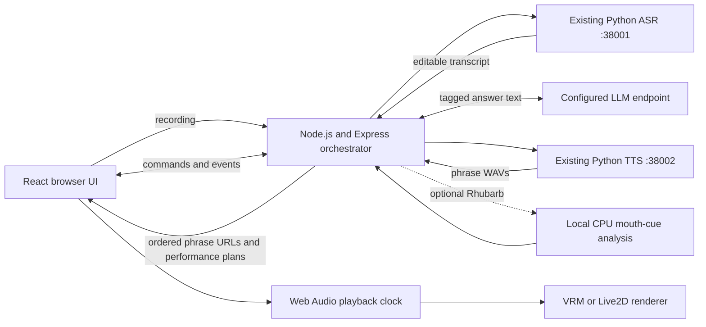

# Digital Human Chatbot — implementation suggestions

Date: 13 October 2026. Status: proposed implementation; application code has not been built.

## Recommended direction

Implement this directory as a **React + TypeScript + Vite frontend and a Node.js + Express + TypeScript orchestration backend**, reusing the existing ASR and TTS HTTP services. Start with the downloaded **Constraint Twist VRM** and add **Haru/Ren Live2D** through a small renderer interface after the first complete conversational flow works.

The application backend uses Express. The available Python/FastAPI speech services remain independent MLX workers, called over HTTP; they do not need to be rewritten in Node. Their code, configuration, request/response contracts and current reachability are studied in [SERVICE_INTEGRATION.md](SERVICE_INTEGRATION.md).

The inputs are [INSIGHTS.md](../../../docs/v1/INSIGHTS.md), [PLAN.md](../../../docs/v1/PLAN.md), the [persona research](../../../docs/v1/personas/README.md), and the implemented [speech service contracts](../services/README.md). Your confirmed preferences are local execution, free sample assets, stylized 3D and Live2D, and English/Mandarin/Cantonese.

`INSIGHTS.md` supports the ASR → LLM → TTS → facial-animation product flow. It does not establish an installable version of Asiabots' proprietary renderer. Build our own implementation of that flow.

`PLAN.md` already provides useful UI, service, session and cancellation requirements. Its opening implementation decision now identifies Express and the local avatar direction; its older photorealistic/MuseTalk sections remain background. This document provides the current implementation proposal.

The target directory has configuration and design documents, with no application runtime yet. Its `.env` and `.env.example` contain the three LLM setting names and the selected ASR/TTS base URLs on ports 38001/38002. Retain the existing LLM values when implementation begins. The old `poc_digital_human_chatbot_any` directory is absent in the current workspace; use this directory as the application root.

## Architecture and stack



| Layer | Suggested implementation | Reason |
| --- | --- | --- |
| Frontend | React, TypeScript, Vite, ordinary CSS | Implements the mockup composition, recording controls, conversation and avatar canvas. |
| Application API | Node.js 24 LTS, Express 5, TypeScript, Zod, native `fetch` | Typed orchestration, validated configuration and HTTP service clients. Node v24.18.0 is already installed locally. |
| Events/control | `ws` attached to the Node HTTP server; HTTP for uploads and media | Text deltas, processing state, Stop/Reset and playback acknowledgements use one channel. |
| Recording uploads | Route-scoped Multer with file/count/field limits | Parse browser multipart recordings before forwarding them using native `FormData`. |
| Default avatar | Three.js + `@pixiv/three-vrm` | Existing sample models expose named vowel, blink and emotion expressions. |
| Illustrated avatar | Official Cubism Web SDK/Core behind a Live2D adapter | Reuses the speech/playback flow with the downloaded model packages. |
| Mouth animation | Browser RMS amplitude by default; optional Rhubarb subprocess | Starts with the available WAV immediately; Rhubarb adds phonetic categories when selected. |
| Playback | Web Audio, queued sources on one audio clock | Schedules phrases in order and synchronizes mouth, gestures, pause and replay. |
| Storage | Bounded in-memory sessions and expiring media files | Appropriate for the initial single-user local application. |

Use the M1 Max's integrated graphics for browser rendering. No separate CUDA worker is required by this design. Performance under simultaneous speech inference still needs measurement. The LLM endpoint's location remains independently configurable; strict offline operation also requires a local LLM and locally cached dependencies.

The diagram uses the currently configured speech ports, **38001/38002**. Their code/example defaults are 8001/8002. The Express client must use explicit `ASR_BASE_URL` and `TTS_BASE_URL` values matching the running service configuration.

Official implementation references: [Node release support](https://nodejs.org/en/about/previous-releases), [Express 5](https://expressjs.com/en/guide/migrating-5/), [Node fetch/FormData/AbortSignal](https://nodejs.org/api/globals.html), [ws server integration](https://github.com/websockets/ws), [Multer uploads](https://expressjs.com/en/resources/middleware/multer/), [three-vrm loading examples](https://github.com/pixiv/three-vrm), [Cubism lip-sync manual](https://docs.live2d.com/en/cubism-sdk-manual/lipsync/), [Rhubarb recognizers and cue format](https://github.com/DanielSWolf/rhubarb-lip-sync).

## Suggested directory layout

```text
digital_human_chatbot_any/
├── .env                         # existing backend settings
├── .env.example                 # documented placeholders/defaults
├── .gitignore
├── IMPLEMENTATION.md
├── SERVICE_INTEGRATION.md        # inspected ASR/TTS contracts and Node adapters
├── README.md                    # actual setup and limitations once built
├── package.json                 # npm workspaces and coordinated dev/build commands
├── personas.json                # identity, asset, renderer, voice mapping, credits
├── backend/
│   ├── package.json
│   ├── tsconfig.json
│   ├── src/
│   │   ├── server.ts            # HTTP server, ws upgrades, shutdown
│   │   ├── app.ts               # Express routes, uploads, static/media, errors
│   │   ├── config.ts            # application-root .env, validation, env overrides
│   │   ├── sessions.ts          # history, active turn, expiry
│   │   ├── pipeline.ts          # one turn's LLM → TTS → cues lifecycle
│   │   ├── media.ts             # opaque media IDs, cleanup, session association
│   │   └── services/
│   │       ├── http.ts          # shared timeout, cancellation and error handling
│   │       ├── llm.ts           # compatible chat-completions endpoint adapter
│   │       ├── asr.ts           # multipart fetch client and transcript validation
│   │       ├── tts.ts           # JSON fetch client and binary WAV handling
│   │       └── lipsync.ts       # async Rhubarb spawn and neutral cue conversion
│   └── tests/                  # lifecycle, provider boundaries, media expiry
├── shared/
│   ├── package.json            # workspace exports for schemas/types
│   └── protocol.ts             # shared request/event schemas and inferred types
├── frontend/
│   ├── package.json
│   ├── vite.config.ts          # development /api and WebSocket proxy
│   ├── public/personas/        # selected assets + required notices, staged locally
│   └── src/
│       ├── App.tsx
│       ├── components/         # AvatarPanel, ChatPanel, Composer, Controls
│       ├── session/            # typed events and UI state reducer
│       ├── audio/              # recording, playback, cue scheduling
│       └── avatars/
│           ├── types.ts        # renderer interface and neutral mouth pose
│           ├── VrmRenderer.ts
│           └── Live2DRenderer.ts
├── scripts/
│   ├── stage-personas.ts       # copy selected verified packages and notices
│   ├── check-services.ts       # configuration and readiness checks
│   └── benchmark.ts            # reproducible turn/stage timing
└── runtime/                   # ignored temporary recordings, WAVs and cues
```

Create files as their milestone needs them. Keep MLX model loading in the existing speech processes. Use npm workspaces, `tsx` for development, and TypeScript compilation for the production Node process; run one backend process while session state is in memory. Put protocol schemas/types in a shared package, and validate runtime messages at both boundaries. Bundle frontend libraries locally and lock dependency versions during implementation.

The current downloaded collection remains the source for staging assets. Copy selected runtime packages with their manifest and applicable notices; retain the Live2D relative file structure. Do not expose the repository root as a static directory. A setup command should stage assets reproducibly rather than requiring manual copying.

## API and event contract

| Interface | Responsibility |
| --- | --- |
| `GET /api/health` | Report application readiness, service ready/busy state, configuration presence and lip-sync executable availability. Report upstream reachability separately from configuration. |
| `GET /api/personas` | List available avatars, renderer capability, credits and per-language speech status; no secret settings. |
| `POST /api/sessions` | Create a bounded, expiring session. |
| `POST /api/sessions/{id}/transcribe` | Accept recording and forward to ASR with `align=false`; return transcript for editing. |
| `WS /api/sessions/{id}/events` | Receive commands and stream typed answer/state/media events. |
| `GET /api/sessions/{id}/media/{media_id}` | Serve session-associated temporary audio using an opaque identifier. |

Suggested command types: `turn.send`, `turn.stop`, `session.reset`, `playback.started`, `playback.ended`, `playback.failed`. Capture persona and language when accepting a turn; changing the selector affects subsequent turns.

Suggested server event types: `turn.started`, `state.changed`, `answer.delta`, `answer.final`, `speech.ready`, `turn.interrupted`, `turn.completed`, `error`. Include `session_id`, `turn_id` and a monotonically increasing session event sequence. The backend reports speech readiness; browser playback callbacks determine when speaking actually starts and ends.

Example `speech.ready` payload:

```json
{
  "type": "speech.ready",
  "session_id": "opaque-session-id",
  "turn_id": "opaque-turn-id",
  "seq": 18,
  "audio_url": "/api/sessions/opaque-session-id/media/opaque-media-id",
  "duration_seconds": 4.2,
  "persona_id": "constraint-twist",
  "language": "en",
  "lip_sync": {
    "method": "rhubarb",
    "cues": [{"start": 0.0, "end": 0.1, "shape": "rest"}]
  }
}
```

Values and cues above are illustrative. Transmit audio as an ordinary media response; JSON carries metadata/cues. Keep all provider response parsing inside adapters. “Any LLM” means the configured compatible API or an explicitly added provider adapter.

## Turn orchestration and cancellation

1. Start an explicit browser session to enable audio. Load the default avatar once and report actual component readiness.
2. Typed input can be sent immediately. For voice input, use `MediaRecorder` with a browser-supported MIME type, upload the recording, and let the user edit the returned transcript before sending.
3. Accept one active turn per session. Bound input/history and stream only user-visible assistant content from the LLM. Reasoning/tool fields must not become spoken text.
4. Store the completed textual answer when text generation finishes. Keep playback status separate, so a speech failure does not lose a valid answer. Exclude unfinished interrupted assistant text from subsequent LLM context while retaining a visible interrupted message.
5. Parse streamed performance tags into clean chat text and complete speech phrases. Synthesize phrases sequentially through the persistent TTS service, starting before LLM completion when a phrase is ready. Respect real sample rates and declared limits.
6. Emit `speech.ready` for each phrase with its index, clean text, performance plan, and media URL. Amplitude mode needs no analysis; optional Rhubarb analyzes each phrase WAV. Emit `speech.queue.finished` after production completes, and retain the turn until the browser finishes all audio.
7. Decode/play through Web Audio. Amplitude mode reads short waveform windows with an `AnalyserNode` before the mute gain, gates silence, and smooths RMS into continuous mouth opening. Rhubarb mode samples cues against the audio clock. Both modes close on pause/Stop/completion; blink/gaze remain separate idle controls.
8. Finish on actual browser playback completion. Return to idle and release mouth weights. Treat playback failure explicitly and offer retry or a labeled audio-only path.

**WebSocket message handling must stay responsive while a turn runs.** Track the active pipeline Promise and an `AbortController` for each turn; dispatch long work without blocking command handling. Serialize command/state mutations, serialize outbound events, bound queues, and abort/invalidate the active turn on Stop, Reset or connection loss. Express error middleware does not catch detached Promise or `ws` handler failures; handle those errors explicitly.

On Stop, the browser stops its audio source immediately and clears scheduled mouth motion before waiting for the backend. Both sides discard stale turn IDs. Reset also clears history and advances the session generation so obsolete results cannot reappear.

Stopping an HTTP request does not stop the existing speech services' Metal inference. They retain their inference slot until completion. Display real busy state and use bounded retry only while the requesting turn remains valid. Compose turn cancellation and stage timeouts using `AbortSignal`, and retain the timeout through response-body consumption. Run Rhubarb with asynchronous `child_process.spawn`, an argument list, a timeout and subprocess cleanup; avoid `spawnSync`, `execSync` and blocking media operations in request handlers.

## Persona and lip-sync choices

The first renderer should load **Constraint Twist** with `GLTFLoader` and `VRMLoaderPlugin`, apply an appropriate idle pose, and animate the registered vowel expressions `aa`, `ih`, `ou`, `ee`, `oh`. Its underlying model has additional face targets; use standard expressions first for compatibility with Seed-san.

Use a renderer interface such as `load`, `applyMouthPose`, `setEmotion`, `update`, `dispose`. Let the central playback controller own audio. A renderer should receive mouth poses rather than independently playing a voice or generating a second timeline.

Rhubarb's English recognizer and non-English `phonetic` recognizer provide initial timed categories. Map them to neutral categories such as closed, wide, narrow and rounded, then translate those into each avatar's available controls. Smooth transitions and reset speech targets on silence. This is an approximation requiring visual evaluation.

For Live2D, the acquired Haru/Ren models declare mouth opening and mouth form; these offer less articulatory detail than a full speech rig. Obtain official Cubism Core/Web dependencies when adding that adapter. Live2D mouth form should not be treated as a standardized vowel selector. Detailed consonant shaping may require a custom rig or the extra MPFB GLB sample.

Amplitude-driven mouth opening is the default for conversational latency. It drives Live2D `ParamMouthOpenY` and VRM `aa` directly without a Rhubarb subprocess or precomputed cues. It follows voice intensity and silence, but does not recognize phonemes or distinguish vowel shapes. Rhubarb remains selectable for phonetic categories. HeadAudio is a later browser-side experiment; its Mandarin/Cantonese behavior remains unverified.

Talking performance follows actual browser playback. Optional `<emotion name="happy" />` and `<gesture name="open_hand" strength="0.5" />` tags precede a phrase. Emotions persist until replaced; gestures apply to the following phrase. Supported gestures are `nod`, `shake_head`, `wave`, `open_hand`, and `shrug`. The prompt asks for sparse gestures and no timestamps. Known malformed/unfinished control tags and unsupported gesture names are ignored; clean text is streamed to chat and stored in history. No control tags reach TTS.

The backend's incremental parser buffers tags split across provider chunks. Sentence boundaries, explicit tag boundaries, and bounded long clauses produce speech phrases. A single synthesis queue prevents concurrent inference against the persistent TTS worker. Replies are bounded to 32 phrases and 120 seconds of generated audio. The first completed phrase can play while later text/audio is still being produced. Additional TTS calls can affect latency and prosody; no ASR/forced-alignment pass is added.

The browser fetches/decode-ahead and schedules contiguous ready phrases on `AudioContext.currentTime`. Gesture curves use the phrase's actual playback position and decoded duration, not wall-clock timers. Pause freezes the timeline and fades to rest; resume continues the same gesture. Stop aborts fetches, stops all scheduled sources, and cancels future phrases. Replay reuses the complete saved audio/performance sequence. If synthesis falls behind playback, the avatar rests during the queue gap. Timing is at phrase boundaries, not individual words.

Code responsibilities:

| Path | Responsibility |
| --- | --- |
| `shared/performance.ts` | Validated gesture, expression and phrase schemas |
| `backend/src/llm/prompts.ts` | Language and optional performance instructions |
| `backend/src/llm/taggedReplyParser.ts` | Incremental tag removal, metadata and phrase boundaries |
| `backend/src/speech/phraseQueue.ts` | Serial ordered synthesis with cancellation |
| `frontend/src/audio/SpeechQueuePlayer.ts` | Audio scheduling, buffering, pause, Stop, replay |
| `frontend/src/audio/amplitude.ts` | Voice-to-mouth response; preserves `.09` / `.55` tuning |
| `frontend/src/performance/` | SDK-independent controller, gesture curves and bounded pose composition |
| `frontend/src/avatars/rig.ts` | Common rig adapter contract |
| `frontend/src/avatars/vrm/` | VRM scene, normalized-bone adapter and tuning |
| `frontend/src/avatars/live2d/` | Initial face/head adapter; body cues omitted |

Explicit phrase plans suppress the automatic arm loop. Idle breathing, blinking and small torso/head shifts remain separate. VRM pose offsets use captured resting rotations, never hip/root translation. Missing optional bones are ignored. Seed-san's binary texture-atlas expressions have geometry-only speech variants so smooth smiles do not slide facial textures. `frontend/src/avatars/vrm/tuning.ts` holds body strength and the preserved mouth ratio of `1`.

All first-party TypeScript/TSX/CSS/JSON/HTML source is formatted, with separated declarations and methods. Use `npm run format` and `npm run format:check`; vendor assets, generated output, runtime files, lockfiles and `.env` files are excluded. `npm run test:queue` checks real Chrome ordering, audio-clock timing, pause, replay and Stop. `npm run test:avatars` checks real Mira/Seed-san bones, smile morphs, a stationary root, return to rest and clock-directed gestures.

Known local asset limitation: Ren uses MOC version 6 and offscreen rendering, while the installed Core/adapter targets older formats. It needs a compatible Core and renderer upgrade together. Use Haru for Live2D amplitude verification with the current runtime.

## Configuration and language behavior

Phrase emotions now reach both the TTS JSON request and the VRM performance
controller. `normal` and `surprise` tag aliases normalize to `neutral` and
`surprised`. The LLM is instructed to emit an initial emotion and change it when
the delivery changes. Facial weights are sustained through the phrase rather
than fading surprise after 2.2 seconds; neutral clears the expression.

Tune individual emotions in `frontend/src/performance/emotions.ts` or scale all
VRM facial weights with `facialExpressionStrength` in
`frontend/src/avatars/vrm/tuning.ts`. Speech variants preserve mouth animation
independently of facial preset overrides. Binary atlas expressions such as
Seed-san's switch textures discretely and interpolate only their geometry.
Thoughtful uses the authored `relaxed` preset and a head tilt.

The Python TTS adapter maps emotion names to delivery instructions in
`../services/tts/emotions.py`. Its `.env` controls reference audio and optional
stable voice style. VoxCPM2 supports this path; Qwen3 1.7B Base and 0.6B
CustomVoice do not implement instruction control. Inspect service health's
`emotion_control` before claiming emotional speech support.

Read the application root's existing `.env` through an explicit resolved path, with operating-system variables taking precedence. Preserve `LLM_BASE_URL`, `LLM_API_KEY`, `LLM_MODEL_NAME`; join the chat-completions path once and handle endpoint streaming capability deliberately. Never put credentials into `VITE_*` variables or event payloads.

Suggested additions for implementation:

```dotenv
APP_HOST=127.0.0.1
APP_PORT=8000
ASR_BASE_URL=http://127.0.0.1:38001
TTS_BASE_URL=http://127.0.0.1:38002
DEFAULT_PERSONA=constraint-twist
DEFAULT_LANGUAGE=en
LIPSYNC_PROVIDER=amplitude
RHUBARB_BIN=rhubarb
LIPSYNC_TIMEOUT_SECONDS=60
SPEECH_TIMEOUT_SECONDS=180
MEDIA_TTL_SECONDS=900
SESSION_TTL_SECONDS=3600
```

The ASR/TTS base URLs above are set in the application's `.env` and `.env.example` as requested; the other additions remain proposed defaults. Add explicit LLM timeouts and bounded retry/history limits when implementing. Keep actual model settings and inference limits in each speech service's own environment.

Use explicit language mapping: UI `en` → ASR `English` / TTS `english`; `zh` → ASR `Chinese` / TTS `chinese`; `yue` → ASR `Cantonese` and a separately verified TTS path. Query service health and validate chosen presets. Input-language support does not establish output voice quality.

The reply selector defaults to `auto`, with English, Mandarin and Cantonese overrides. Auto resolves Cantonese text markers first, otherwise Han text to Mandarin (or preserves an established Cantonese conversation), and Latin text to English. Symbols/numbers retain the previous language. It adds no LLM classification call. Formal Chinese text alone cannot reliably distinguish spoken Cantonese from Mandarin; use an override when needed. The resolved language reaches both LLM and TTS. Auto microphone requests send `auto` to ASR, and recognized language provides a session hint. Reset clears that hint.

Validate changes with `npm test`, `npm run build`, `npm run format:check`, `npm run test:playback`, `npm run test:queue`, `npm run test:avatars`, and `npm run test:browser`. The playback check runs real Chrome Web Audio against a silence/tone fixture to check mute, pause/resume, Stop, natural completion, and Rhubarb compatibility. The full browser check uses mock speech/LLM services and a deliberately missing Rhubarb binary in amplitude mode; it does not establish real Cantonese pronunciation quality.

To run the UI checks against the three avatars supported by the installed runtime, use `BROWSER_PERSONAS=haru,seed-san,constraint-twist npm run test:browser`. The default checks all four personas and exposes Ren's existing runtime incompatibility.

English and Mandarin can use the current TTS presets for initial evaluation. Cantonese text and transcription can be exercised independently; expose Cantonese speech only when listening checks pass. If the current voice fails, the persona research records a separate local CosyVoice evaluation candidate. That would require validating its environment/adapter, rather than assuming a configuration-only swap.

## Implementation order and completion evidence

| Milestone | Work | Evidence required |
| --- | --- | --- |
| 0: renderer/speech feasibility | Render Constraint Twist and play real English/Mandarin TTS WAVs with CPU-generated cues; test Cantonese voice quality early | Visible synchronized mouth motion; observed stage timing and memory; actual renderer loaded |
| 1: application foundation | Backend settings, provider clients, session/event schemas, typed chat and UI state | Configured LLM works; bounded multi-turn context; Stop works during text generation |
| 2: complete voice turn | Recording/upload/review, TTS, cues, expiring media and audio-clock playback | Fresh user query → fresh answer → speaking avatar; no duplicate audio or stale playback |
| 3: Live2D and persona selection | Add Cubism adapter, stage Haru/Ren, expose credits and verified voice mapping | Same response WAV works with both renderer families; no duplicated conversation logic |
| 4: demonstration | Match mockup layout, accessibility, language checks, failure cases and launch documentation | Repeatable demo with measured limits and per-language status |

Build and exercise the avatar feasibility slice before UI polish. Start with complete short answers; introduce sentence-level TTS/cue batching only after measuring the dominant latency. The current TTS HTTP service is buffered even though its separate CLI supports streaming.

Focus automated tests on interrupted tasks, stale events/media, provider streaming/nonstreaming parsing, busy responses and media expiry. Add browser checks for Stop/Reset, recording permissions and autoplay failure. Use manual listening and visual inspection for language quality and facial animation; avoid tests that merely repeat adapter implementation.

Retain the earlier plan's approximate 150 ms lip-sync offset, 300 ms browser Stop response and warm short-reply timing goals as evaluation targets. Measure p50/p95 and cold starts; no such performance is established by this proposal. The completed application must demonstrate genuine reply-driven face animation as well as working chat and audio.

The first concrete deliverable should be **one complete typed turn producing a new TTS WAV and synchronized VRM speech**, followed by recording/transcription and the Live2D adapter. This resolves the central local-rendering question with the assets and speech foundation already available.
