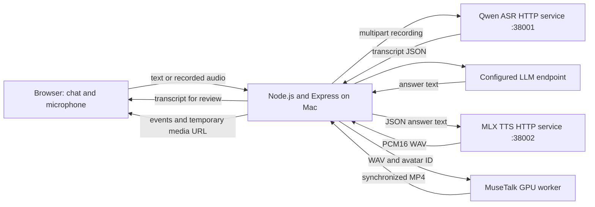

# Digital Human Chatbot POC — Proposed Implementation

Status: POC proposal with ASR/TTS service implementation, updated 13 October 2026. Chatbot destination: `codes/v1/digital_human_chatbot_any/`; shared speech services: `codes/v1/services/`.

**Current implementation decision (13 October 2026):** the chatbot backend will use **Node.js + Express + TypeScript**. Existing Python/FastAPI ASR and TTS processes remain independent HTTP speech services. The selected avatar direction is local **VRM first, Live2D second**. Follow [the current implementation proposal](../../codes/v1/digital_human_chatbot_any/IMPLEMENTATION.md) and [inspected service contracts](../../codes/v1/digital_human_chatbot_any/SERVICE_INTEGRATION.md); their local-avatar architecture supersedes the older MuseTalk/remote-GPU sections below. Local speech `.env` files currently select ports **38001/38002**, while the service code/example defaults remain 8001/8002.

## 1. Recommendation

Build a browser chatbot matching the composition of `MOCKUP_1.png`: a large photorealistic presenter on the left and text conversation on the right. Users can type or record a question; a configurable LLM answers; local speech synthesis produces the voice; an audio-driven renderer makes the presenter speak that exact audio.

Use **React + TypeScript + Vite** for the UI and **Node.js + Express + TypeScript** for orchestration, with independent **Qwen ASR and MLX TTS HTTP services** on this Mac. The current avatar implementation follows the local VRM/Live2D proposal linked above; MuseTalk remains the original photorealistic research route. Keep the existing `LLM_BASE_URL`, `LLM_API_KEY`, and `LLM_MODEL_NAME` configuration so the conversation model remains replaceable.

The first complete POC should generate and play a synchronized video for each short answer. This proves the essential experience before attempting continuous streaming. Call this version **turn-based, near-real-time conversation**; measure its delay rather than describing it as an instant live system.

**Main dependency:** the current machine is Apple Silicon, while the selected renderer has a CUDA-oriented setup. A usable GPU worker and a suitable presenter asset must be established in the first milestone. A local chat UI with an idle image is an intermediate deliverable, not completion of the digital human POC.

## 2. What the references establish

| Reference | Observation | Consequence for this POC |
| --- | --- | --- |
| [INSIGHTS.md](INSIGHTS.md) | Describes ASR → conversation → TTS → facial animation, and distinguishes disclosed technologies from unknown proprietary models. | Reproduce the pipeline and user experience with our own components. Do not claim to reproduce Asiabots' internal engine. |
| [ASIABOTS_REF.png](ASIABOTS_REF.png) | Separates 2.5D animation, 3D polygon characters, and photorealistic digital humans. | Target the third category: a realistic human appearance with speech-driven mouth animation. |
| [MOCKUP_1.png](MOCKUP_1.png) | Shows a roughly 57/43 presenter/chat split, rounded white panels, red user bubbles, subtitles, microphone controls, and a language selector. | Use this as the visual and interaction direction, with our own identity and functioning controls. |

Asiabots publicly describes diffusion-generated character imagery, lip-sync, face-swapping, and its own animation engine. These descriptions support the broad approach, but do not identify a model we can simply install. Face-swapping is unnecessary for a POC using one original presenter. Sources: [Asiabots development history](https://www.asiabots.com/blog/the-evolution-of-digital-human-in-asia-asiabots-digital-human-ambassador), [Asiabots technology](https://www.asiabots.com/technology).

## 3. Existing code and constraints

Current state after the speech service revision:

- The POC directory contains `.env` and `.env.example`, with no application code yet. Its example config names `qwen/qwen3.6-35b-a3b`; this is a configured value, not a verified available model.
- [ASR service](../../codes/v1/services/asr/README.md): Qwen3-ASR, configured through the existing `QWEN_ASR_MODEL_ID`, with optional Qwen3-ForcedAligner timestamps. The model ID now comes from configuration instead of the former hard-coded 8-bit model. Default/example: `mlx-community/Qwen3-ASR-1.7B-bf16`.
- [TTS service](../../codes/v1/services/tts/README.md): a persistent MLX model with a WAV-returning HTTP endpoint. The streaming playback CLI remains available; host playback is excluded from the HTTP path. Default/example: `mlx-community/Qwen3-TTS-12Hz-0.6B-CustomVoice-4bit`, voice `Vivian`.
- Each service has its own `pyproject.toml`, `.env.example`, launch entry point, health endpoint, and API documentation. Existing `.env` files are preserved.
- The configured interpreter expands to `~/.common-venv/python3.12/bin/python3`; it contains Python 3.12 and `mlx-audio==0.5.0`. FFmpeg is installed, and this Mac has 64 GiB unified memory. The system Python 3.9 is not the service interpreter.
- GPU renderer availability, LLM endpoint compatibility, sustained speech latency, and Cantonese voice quality still need validation.

The chatbot backend should call the services over HTTP rather than importing MLX or loading speech models itself. TTS now derives WAV sample rate from actual generated chunks. ASR uses the model API directly, correcting the old `audio_path` call and avoiding transcript-file side effects. Browser playback remains the only audible output during the digital human flow.

## 4. POC scope

### Required for completion

1. One original or licensed photorealistic presenter, with an idle visual and a consistent speaking appearance.
2. Typed chat with short multi-turn memory and streamed answer text when supported by the configured endpoint.
3. Click-to-record microphone input, local transcription, and an editable transcript before sending.
4. Spoken answers with genuine audio-driven lip-sync. The rendered video must use the same waveform generated for the answer.
5. States for starting, ready, recording, transcribing, thinking, rendering, speaking, and errors.
6. Captions, mute, stop response, clear conversation, and presenter fullscreen controls.
7. English and Mandarin demonstration paths. Evaluate Cantonese early because it appears in the existing speech experiment; expose it as a supported voice mode only after it passes a separate listening/transcription check.
8. A documented local launch procedure, renderer setup procedure, and repeatable demonstration.

### Deferred

Continuous listening, automatic voice interruption, generative hand gestures, live camera input, face-swapping, voice cloning, avatar training, multiple simultaneous users, retrieval infrastructure, authentication, and production deployment.

Use a generic assistant persona initially. If a domain demo is useful, provide a small explicit FAQ in the system context; do not present invented company information as fact.

## 5. Technology choices and alternatives

| Layer | Proposed choice | Why / validation needed |
| --- | --- | --- |
| UI | React, TypeScript, Vite, ordinary CSS | Direct control over the mockup layout, recording, media playback, and state. |
| Backend | Node.js, Express 5, TypeScript, Zod, native `fetch`, `ws` | One orchestration service with bounded multipart uploads and a WebSocket event channel. |
| LLM | Configured chat-completions-compatible endpoint | Preserve the existing three variables. Verify URL conventions, model availability, authentication, and streaming before integration. |
| ASR | Qwen3-ASR service at `http://127.0.0.1:38001` | Multipart upload, FFmpeg normalization, transcript JSON, optional forced alignment. [Qwen ASR/aligner documentation](https://github.com/Blaizzy/mlx-audio/blob/main/mlx_audio/stt/models/qwen3_asr/README.md). |
| TTS | MLX TTS service at `http://127.0.0.1:38002` | JSON text request → complete PCM16 mono WAV. Default model/voice remain configurable; inspect health for capabilities. [MLX Audio](https://github.com/Blaizzy/mlx-audio). |
| Avatar | MuseTalk 1.5 in an isolated GPU environment | Audio-driven mouth animation over prepared presenter footage. Gate adoption on our own quality and timing measurements. |
| Media | FFmpeg; browser-compatible MP4 with audio | A muxed audio/video artifact provides one playback clock and a straightforward first integration. |
| Session data | Bounded in-memory history and temporary media files | Sufficient for a single-user POC; no database required. |

**Renderer evidence and limits:** MuseTalk documents CUDA setup, prepared-avatar inference, and 30+ FPS on a V100. That is an inference benchmark, not an end-to-end conversational guarantee or a Mac benchmark. Its generated face region is 256 × 256; a large presenter panel therefore needs visual inspection. It modifies the mouth region; motion outside that region comes from the source footage. [Official MuseTalk repository](https://github.com/TMElyralab/MuseTalk).

**Alternative if a GPU worker is unavailable:** evaluate D-ID's current echo-session integration, which accepts our generated audio and returns a live talking avatar. It preserves ownership of the LLM and voice pipeline, but requires a supported v4 expressive agent, service credentials, and budget; it uses LiveKit and changes the media integration. Keep this as one alternative, not a second implementation to build in parallel. Do not use deprecated stream APIs. [D-ID echo sessions](https://docs.d-id.com/docs/echo-sessions-quickstart).

**Local-only boundary:** the evidence reviewed does not establish real-time MuseTalk operation on this Mac. Chat and voice can be developed locally, but the avatar milestone remains unresolved until either the GPU renderer or the managed alternative works. A 3D avatar would change the selected visual direction and is outside this proposal.

## 6. Architecture and turn lifecycle



1. The user starts the session explicitly, enabling audio playback. The backend reports actual component readiness; the presenter shows an idle loop or portrait while ready.
2. Typed input goes directly to a new turn. The backend forwards recorded browser audio to the ASR service. ASR enforces file/duration limits, converts the container to 16 kHz mono PCM16 using FFmpeg, transcribes it, and deletes temporary input files.
3. Transcription is returned to the composer for review. Sending it starts the same pipeline as typed input. Do not add silence or an empty transcript to conversation history.
4. The backend assigns a session and turn ID, submits bounded history to the LLM, and forwards visible answer text to the chat panel. Use short replies, initially one or two sentences. Provider reasoning fields must not be spoken or displayed as the answer.
5. Once answer text is complete, sanitize it for speech and call the TTS service to receive one complete WAV. Each speech service loads once during startup and performs inference on its own single dedicated thread; the chatbot process remains independent of MLX.
6. Submit that WAV and a prepared avatar ID to the GPU worker. It renders and muxes speech with video. Return the resulting file through the backend, avoiding browser dependence on a GPU worker's private address.
7. The browser loads the MP4, switches from idle only when it can play, and uses its audio as the sole speech output. Show the answer caption while the clip plays. Do not play TTS early while the face is still rendering.
8. On completion, return to idle. On Stop, pause media immediately, cancel or invalidate pending work, and discard every late event for the stopped turn. A stopped response remains visibly marked as interrupted.

Allow one active turn per session. Reset must clear history and invalidate outstanding turn IDs. A failed avatar render should preserve answer text and offer an explicit audio-only retry; degraded playback must not be reported as a successful avatar turn.

### Proposed interfaces

| Interface | Responsibility |
| --- | --- |
| `GET /api/health` | Report LLM configuration, speech readiness, and renderer availability separately. |
| `POST /api/sessions` | Create a bounded in-memory conversation. |
| `POST /api/sessions/{id}/transcribe` | Receive a recording and return editable transcript text. |
| `WS /api/sessions/{id}/events` | Receive send/stop/reset commands; emit state, text delta, final text, media-ready, completion, and error events with turn IDs. |
| `GET /api/media/{id}` | Serve session-owned temporary media with seeking/range support. |
| Worker: `POST /render`, `GET /jobs/{id}`, `DELETE /jobs/{id}` | Submit audio, inspect render progress, and cancel where possible. This is our wrapper around MuseTalk, not an upstream API. |

### Implemented speech service contracts

| Service | Request | Result |
| --- | --- | --- |
| ASR `GET /health` | No body | Ready/busy state, loaded model, alignment availability, languages. |
| ASR `POST /v1/audio/transcriptions` | Multipart `file`; optional `language`, `align`. | `text`, detected `language`, `segments`, aligned `words`, `alignment_performed`, input duration, processing seconds. |
| TTS `GET /health` | No body | Ready/busy state, loaded model, supported preset voices and languages. |
| TTS `POST /v1/audio/speech` | JSON `text`; optional `voice`, `language`, `instruct`. | Complete `audio/wav`; headers report sample rate, audio duration, and processing seconds. |

Both expose Swagger at `/docs` and OpenAPI at `/openapi.json`. ASR defaults to 20 MiB/60 seconds input and optional alignment enabled; TTS defaults to 2,000 text characters, 120 seconds output, and 1,024 tokens per model segment. The existing service `.env` files are preserved; new settings have defaults and are documented in their `.env.example` files.

The backend should request `align=false` when it only needs an editable transcript, avoiding the extra timestamp pass. Its health route should call both service health endpoints instead of inferring readiness from configuration. HTTP 429 means a service is busy; use bounded retries only while the turn remains active. Display validation errors (422), file/duration limits (413), decode timeout (408), and inference failures (500) appropriately. Set explicit client timeouts and discard late results after Stop/Reset. Metal inference itself cannot be forcibly interrupted by an HTTP disconnect; the service holds its slot until it finishes.

These APIs bind to localhost by default and are intended for backend-to-service requests. To split hosts, configure the service bind address and backend URLs. HTTP speech streaming, a job/cancel API, authentication, and production hosting are deferred. The streaming TTS CLI remains available for local experiments; the HTTP endpoint deliberately returns a complete WAV for the avatar renderer.

Initially transfer complete WAV/MP4 files between backend and renderer. Whole-answer buffering is deliberate for the first milestone. If delay fails the target, evaluate sentence-level generation and ordered playback next; continuous WebRTC streaming is a later transport change.

## 7. UI behavior based on the mockup

- Desktop: approximately 57% presenter / 43% chat; soft background, rounded panels, restrained shadows, dark text, and red send/user-message accents. Mobile: stack the presenter above chat and keep the composer reachable.
- Presenter: stable upper-body framing, uncluttered background, small status badge, readable caption overlay, mute, stop, and fullscreen. Use a neutral hand pose for the initial source footage so a looping wave does not repeat during every answer.
- Chat: presenter thumbnail, assistant name, actual status, scrollable transcript, gray assistant bubbles, red user bubbles, and a thinking indicator only while work is pending.
- Composer: input, send, and recording toggle. During recording, show duration and an explicit stop action. Handle permission denial by keeping typed chat available.
- Language selector: controls reply language and a verified TTS voice/language mapping. It must not advertise unsupported languages. Cantonese transcripts may need Traditional Chinese normalization; this does not establish Cantonese speech quality.
- Omit the camera icon until a camera feature exists. Replace Asiabots' name/logo and footer with our own POC identity. Include an unobtrusive AI-presenter label.
- Make primary actions keyboard accessible and label icon buttons. If autoplay is blocked, show a Play response action; subtitles and chat remain usable.

## 8. Presenter assets

Prepare one presenter before UI polish:

- A clean portrait and a short, front-facing idle/source video with restrained head movement, consistent lighting, a visible mouth, and no face occlusion.
- A consistent thumbnail, display name, and voice preset.
- A prepared renderer cache keyed by presenter asset version and renderer revision.
- Asset provenance and the relevant usage permissions in `assets/avatars/README.md`. Use original, synthetic, or licensed material rather than extracting the Asiabots presenter from the mockup.

Source footage supplies blinking and body motion. The first POC does not generate new gestures for each answer. Tune crop, face compositing, and idle/speaking transitions on a small sample before preparing the full asset.

## 9. Proposed directory layout

The shared speech services live outside the chatbot directory so they can be launched and reused independently:

```text
codes/v1/services/
├── README.md
├── asr/
│   ├── asr_audio.py, asr_api.py
│   ├── pyproject.toml, .env.example, .gitignore
│   └── README.md
├── tts/
│   ├── stream_audio.py, tts_api.py
│   ├── pyproject.toml, .env.example, .gitignore
│   └── README.md
└── tests/test_services.py
```

The remaining chatbot implementation belongs inside the requested destination:

```text
codes/v1/digital_human_chatbot_any/
├── .env                         # existing local settings; preserve values
├── .env.example                 # documented placeholders only
├── .gitignore
├── README.md                    # prerequisites, launch, demo, limitations
├── backend/
│   ├── package.json, tsconfig.json
│   ├── src/
│   │   ├── server.ts, app.ts
│   │   ├── config.ts
│   │   ├── sessions.ts
│   │   ├── pipeline.ts
│   │   └── services/            # llm, ASR/TTS HTTP clients, avatar, media
│   └── tests/                   # lifecycle and provider-boundary checks
├── frontend/
│   ├── package.json
│   └── src/                     # presenter, chat, composer, event client
├── avatar_worker/
│   ├── README.md
│   ├── requirements.txt         # separate CUDA dependency environment
│   └── app.py                   # prepared-avatar render job wrapper
├── assets/avatars/
│   ├── README.md
│   └── presenter-01/            # portrait, thumbnail, source, manifest
├── scripts/                    # setup checks, launch, benchmark
└── runtime/                    # ignored recordings and generated media
```

ASR and TTS can share the existing Python 3.12 interpreter or use separate service environments. Their manifests pin `mlx-audio==0.5.0`, matching the installed model API. Keep CUDA renderer dependencies in a separate environment, and keep MLX out of the chatbot backend dependencies. Run one process/worker per speech service to avoid replicating models. Pin the renderer revision after its feasibility spike.

### Configuration contract

Keep `LLM_BASE_URL`, `LLM_API_KEY`, and `LLM_MODEL_NAME` unchanged. Document `LLM_BASE_URL` as the API root, normally including `/v1`, and join the completion path exactly once. Support non-streaming responses if the endpoint lacks streaming. “Any LLM” means compatible endpoints or an added adapter, not every vendor's native API automatically.

Use `ASR_BASE_URL=http://127.0.0.1:38001` and `TTS_BASE_URL=http://127.0.0.1:38002` in the chatbot configuration, plus speech request timeouts, `DEFAULT_LANGUAGE`, `AVATAR_PROVIDER`, `AVATAR_ID`, `MEDIA_DIR`, and media expiry. The current local-avatar configuration is specified in `IMPLEMENTATION.md`; worker URL/token settings apply only to the historical remote-renderer route. Model IDs, alignment settings, voice defaults, ports, and inference limits belong to each speech service's `.env`, not the chatbot. Each service resolves its `.env` beside its code, with process environment variables taking precedence. `PYTHON_BASE` documents the speech-service launch interpreter rather than changing Python at runtime. Keep credentials on the backend; expose only nonsecret capabilities to the UI.

## 10. Milestones and exit criteria

| Milestone | Work | Exit evidence |
| --- | --- | --- |
| M0 — feasibility | Verify interpreter/packages and LLM endpoint; warm ASR/TTS; render sample speech on the chosen worker; inspect presenter quality. | English and Mandarin WAVs and synchronized videos, timing/memory measurements, and one confirmed renderer deployment route. Evaluate Cantonese separately. |
| M1 — text conversation | Build the two-panel UI, backend configuration, session history, text streaming, and cancellation. | Typed multi-turn chat works with the configured endpoint; no credentials reach the browser. |
| M2 — speech integration | ASR/TTS APIs are implemented. Add chatbot HTTP clients, browser recording, transcription review, and development audio playback. | Browser → backend → ASR API → review → LLM → TTS API → browser works; handle busy/error responses and stale turns. |
| M3 — actual digital human | Add prepared avatar jobs, media serving, synchronized playback, captions, idle transitions, and failure recovery. | Fresh LLM answers drive fresh lip-synced videos; Stop/Reset cannot revive stale media. This is the first complete POC. |
| M4 — demo readiness | Match the mockup, verify languages, measure repeated turns, document setup and known limits. | Repeatable demo and recorded acceptance results, with remaining latency gaps explicitly documented. |

Planning estimate: roughly **7–12 focused engineering days**, assuming access to a working GPU environment and usable assets. This is an estimate, not a commitment; reassess after M0. Model downloads, renderer compatibility, and asset revisions can dominate elapsed time.

M0 is the critical gate. If the renderer route cannot produce acceptable speech animation, settle that dependency before polishing the application. Do not train a model or build multiple rendering stacks to rescue an unvalidated choice.

## 11. Validation and success measures

### Speech service validation completed

On 13 October 2026, both service processes were started on temporary localhost ports and exercised over HTTP using the configured Python 3.12 interpreter and real MLX models:

| Check | Observed result |
| --- | --- |
| ASR health | Ready; loaded the configured bf16 Qwen3-ASR model and forced aligner; returned language capabilities from the installed model configuration. |
| ASR transcription + alignment | A 1.84-second English recording returned “Hello. How are you today?” with aligned units; processing took approximately 1.23 seconds. |
| TTS health | Ready; loaded the default 0.6B CustomVoice model; reported preset voices and languages. |
| TTS synthesis | The same English sentence produced 5.20 seconds of PCM16 mono audio at 24 kHz; inference took approximately 3.40 seconds. |
| API contracts | 13 automated tests pass, covering normalization, limits, alignment compatibility, actual WAV rate, model reuse, errors, busy responses, and repeated request cancellation. |

These are individual first-request observations after readiness, not sustained warm benchmarks. Startup took about 15 seconds for ASR and 106 seconds for TTS in this run; first-use model downloads affected startup. Test servers were stopped after verification. Mandarin/Cantonese quality, sustained latency, and avatar rendering still require their own checks. During integration, the ASR adapter was adjusted for `mlx-audio==0.5.0`, which reports language lists in transcription results and exposes supported languages through model configuration.

### Remaining POC acceptance

Acceptance should use newly generated answers, not prerecorded responses:

1. Complete ten consecutive short turns in English and ten in Mandarin, including follow-up questions that depend on prior context. At least one spoken question per language must go through recording and transcript review.
2. Inspect visible lip synchronization, identity consistency, mouth/teeth artifacts, and return to idle on those clips. Target audio/video offset within approximately 150 ms on sampled clips, checked with waveform and frame inspection.
3. Measure warm submit-to-first-text, ASR processing, TTS generation, renderer queue/inference/mux, transfer, and browser start. For spoken input, also report recording-stop-to-transcript-ready separately. Log cold starts separately.
4. Initial engineering targets for short replies: warm median submit-to-first-text under 2 seconds and submit-to-audible synchronized video under 8 seconds. Report p50/p95 and hardware/model settings; these are targets, not established capabilities. A functional demo missing them must be described as having a latency gap.
5. Stop playback within roughly 300 ms in the browser. Test Stop during LLM, TTS, render, and playback; Reset and rapid resubmission must never play an obsolete turn.
6. Exercise empty audio, microphone refusal, LLM timeout/authentication errors, renderer outage, unsupported recordings, blocked autoplay, and page refresh. Text remains readable; retry must not duplicate completed messages.
7. Verify desktop and narrow-screen layouts, keyboard controls, and temporary-file cleanup. Keep automated checks focused on lifecycle races, adapter failures, and media validity; use manual listening/visual review for avatar quality.

The POC is complete when the functional flow and actual lip-sync pass, setup is reproducible, and measured limitations are documented. A static portrait with audio, mouth movement driven only by volume, or unrelated speaking loops does not satisfy the avatar requirement.

## 12. Main risks and practical responses

| Risk | Response |
| --- | --- |
| No working renderer on available hardware | Resolve GPU access in M0; evaluate the managed echo alternative if necessary. |
| Speech models exceed local memory or latency budget | Measure warm memory and speed, limit answer length, serialize inference, then compare smaller models. |
| Cantonese is transcribed but synthesized poorly | Test native Cantonese phrases and mixed English terms with a fluent listener; do not equate general Chinese support with Cantonese support. Keep that voice mode unavailable until verified. |
| Large presenter panel reveals face artifacts | Validate at the actual display size; improve source footage/crop or reduce effective display size before adding enhancement models. |
| Whole-answer rendering feels slow | Keep answers short; measure the dominant stage; introduce sentence-level pipelining only with ordered playback and preserved audio/video timing. |
| Interrupted tasks produce stale playback | Turn IDs, bounded queues, cancellation where supported, and unconditional stale-result rejection. |
| Temporary recordings and GPU transfers linger | Use authenticated worker calls, short media expiry, size limits, and cleanup on session expiry; document that audio leaves the Mac for remote rendering. |
| Ongoing infrastructure cost | Record GPU uptime, render seconds, storage, and LLM usage during the demo; stop idle workers. Obtain current provider pricing before provisioning paid infrastructure. |

The speech service APIs are now implemented. The next POC action is **M0: validate the configured LLM connection and one complete TTS-WAV-to-avatar render**, then connect the chatbot to the two HTTP services. Full avatar rendering remains unimplemented.
