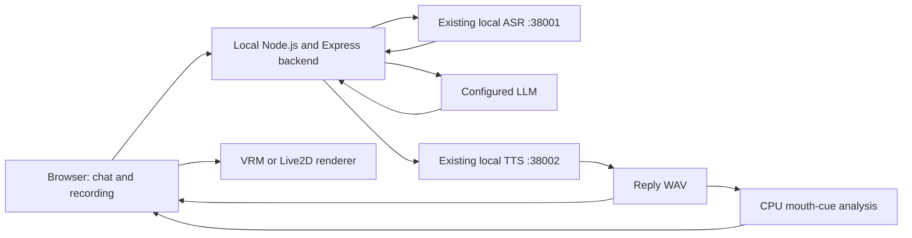

# Proposed local integration and evaluation

This is an implementation proposal, not an installed renderer. The downloaded models and verification utility are complete; the chatbot UI, model loaders and lip-sync adapter remain future application work.

## Architecture



Only the LLM's configured location is unresolved. For strict offline execution, use a local LLM endpoint and cache all speech weights, model files and frontend dependencies. Avoid CDN imports in the final offline build. The avatar requires neither a remote worker nor generated reply video.

The future backend calls the existing services and serves response media from the same origin as the UI. This avoids depending on CORS support in the internal ASR/TTS services. Keep model URLs in persona configuration and copy selected model packages into the application's static assets during integration, preserving license/provenance files.

## Suggested renderer interfaces

Keep avatar identity separate from voice and conversational role:

```json
{
  "id": "constraint-twist",
  "renderer": "vrm",
  "modelUrl": "/personas/constraint-twist/VRM1_Constraint_Twist_Sample.vrm",
  "voiceByLanguage": {"en": "Ryan", "zh": "Vivian", "yue": null},
  "conversationRole": "A concise, helpful general assistant"
}
```

This is illustrative configuration. English/Chinese preset names must be checked against TTS `/health`; Cantonese has no approved voice yet. Changing a voice does not change the model's appearance or its license.

Use a small renderer boundary such as `load(modelUrl)`, `setMouth(cue)`, `setEmotion(value)`, `setSpeaking(active)` and `dispose()`. A common mouth-cue object can hold timestamps, openness and a shape category. Translate that object into the parameters available on each rig.

- **VRM:** load using `GLTFLoader` with `VRMLoaderPlugin`. Apply `aa`, `ih`, `ou`, `ee`, `oh` through `vrm.expressionManager`, then update the VRM each animation frame. Add an idle pose, gaze and blinking. Confirm emotion overrides do not suppress the mouth. [three-vrm loader documentation](https://github.com/pixiv/three-vrm), [expression API](https://pixiv.github.io/three-vrm/docs/classes/three-vrm.VRMExpressionManager.html).
- **Live2D:** obtain official Cubism Core/Web framework, load `.model3.json`, and resolve its referenced files. Read the `LipSync` group rather than hard-coding all models to one parameter. Apply speech controls in the correct SDK update order so an idle motion does not overwrite them. Query parameter ranges from the runtime; `ParamMouthForm` is a mouth-form control, not a universal vowel selector. [Cubism lip-sync update guidance](https://docs.live2d.com/en/cubism-sdk-manual/lipsync/).
- **GLB:** Three.js can control morph weights directly. Build a name-to-target lookup for every affected mesh, including teeth/tongue; update all corresponding targets. TalkingHead is an optional higher-level adapter requiring compatible rigs and morph conventions. [TalkingHead compatibility guide](https://github.com/met4citizen/TalkingHead#appendix-a-create-your-own-3d-avatar).

## First audio-to-mouth experiment

Use the existing TTS CLI with `--no-play`, or its HTTP endpoint, to produce the exact WAV used for the comparison. Do not animate from the microphone or the user's ASR timestamps while playing the assistant's reply.

After separately installing/building Rhubarb for the host, examples are:

```bash
rhubarb -r pocketSphinx -f json -o english.cues.json english.wav
rhubarb -r phonetic -f json -o mandarin.cues.json mandarin.wav
rhubarb -r phonetic -f json -o cantonese.cues.json cantonese.wav
```

These commands illustrate the proposed experiment; Rhubarb and test WAVs were not installed/generated by this research task. Check the macOS release architecture: an Intel binary may require Rosetta, or build a compatible binary. Rhubarb analyzes the complete audio file and adds processing latency. [Upstream setup, recognizers and JSON output](https://github.com/DanielSWolf/rhubarb-lip-sync).

Rhubarb's mouth categories are not VRM preset names. Start with an explicit, tunable mapping:

| Cue category | VRM sample behavior | Live2D sample behavior | Fidelity limit |
| --- | --- | --- | --- |
| Rest / closed lips | Release vowel weights | Set mouth opening to zero | No dedicated lip-press control in these sample interfaces |
| Wide open | Blend toward `aa` | Increase mouth opening | Character-specific opening needs tuning |
| Narrow / spread | Blend `ih` / `ee` | Smaller opening, tuned mouth form | Live2D mouth form need not correspond to a vowel |
| Rounded | Blend `oh` / `ou` | Approximate using available opening/form | Supplied Live2D rig may not form a true rounded lip shape |
| Teeth / tongue consonant | Approximate with available shapes | Approximate with available shapes | Detailed articulation requires a richer rig |

Tune weights by inspection; smooth transitions and avoid driving every vowel to full strength at once. These mappings are approximations, not a universal phonetic decoder. For the MPFB model, the explicit speech targets offer more differentiation; still validate the cue mapping and release unavailable targets safely.

As a second experiment, evaluate HeadAudio locally. It outputs viseme weights from an AudioWorklet and can be mapped to VRM controls, though this compresses its richer output into five vowel presets. Compensate measured analysis delay in playback. The provided English-oriented model's Mandarin/Cantonese performance is an open question. [HeadAudio usage and limitations](https://github.com/met4citizen/HeadAudio).

## Playback and lifecycle

Decode the WAV using Web Audio and schedule one audio source. Drive timed cues from the **same audio clock**, using scheduled start time and pause/resume offsets; avoid advancing speech with unrelated animation-frame elapsed time. Keep one audible path. A separate avatar sample sound, TTS host playback or another HTML audio element would duplicate or desynchronize output.

Start only when both model and WAV/cues are ready. On silence/end, release the mouth smoothly and return to idle. Mute should silence output while retaining the animation timeline; Stop should stop audio and mouth movement immediately. Pause/resume must freeze/rebase the cue clock. Tag each result with a turn ID and reject late results after Stop/Reset.

The existing TTS service does not forcibly cancel MLX inference on disconnect. Stop can still end browser playback immediately; the backend must discard the obsolete result and respect the service's occupied inference slot. The first version should use short complete replies. Sentence batching is a later latency improvement, not a property of the current HTTP endpoint.

## Evaluation and acceptance

1. **Loader checks:** render Constraint Twist and Haru first; then Seed-san and Ren. Check textures, framing, idle pose, eyes and mouth controls individually. Render the MPFB comparison only if richer facial shapes are useful.
2. **Shared speech set:** use the same actual TTS WAV for each avatar comparison. Begin with 5–10 short utterances per language, then test ten complete conversational turns per language with follow-ups.
3. **Language quality:** ask a fluent listener to check intelligibility, correct language, voice consistency and Cantonese pronunciation. Sample prompts: English “Please bring me a blue paper map”; Mandarin “你好，請幫我查一下明天的安排”; Cantonese “你好呀，唔該幫我睇吓聽日有咩安排。” Include numbers and “我想 book 聽朝十點嘅 meeting。” for Cantonese code-switching.
4. **Visual quality:** inspect closed lips in /m, b, p/, open/rounded vowels, pauses, blinking and emotion overlap. A volume-only baseline must not be recorded as validated phonetic lip-sync. The limited Live2D sample rig may need a revised fidelity target or custom mouth parameters.
5. **Timing:** report TTS generation time, cue-generation time, audio-ready-to-start delay and visible offset. Reuse the earlier plan's approximate 150 ms synchronization target as an evaluation target, not a measured result. Record cold starts separately from warm turns.
6. **Hardware contention:** measure rendering frame time while ASR/TTS run; aim for at least 30 FPS as an initial target. Start around 720p with capped pixel ratio and one avatar; record actual p50/p95 timing, memory pressure and browser/hardware versions.
7. **Controls:** check Stop during generation/playback, pause/resume, mute, rapid resubmission, Reset, failed synthesis and blocked autoplay. Target the earlier plan's roughly 300 ms browser Stop response and verify stale turns never play.

Select the default based on this comparison. My proposed order is **Constraint Twist → Haru → Ren/Seed-san as extra identities**, retaining MPFB for detailed-mouth experiments. If Cantonese speech or the mouth rig fails, record the specific gap rather than describing the entire three-language experience as complete.
