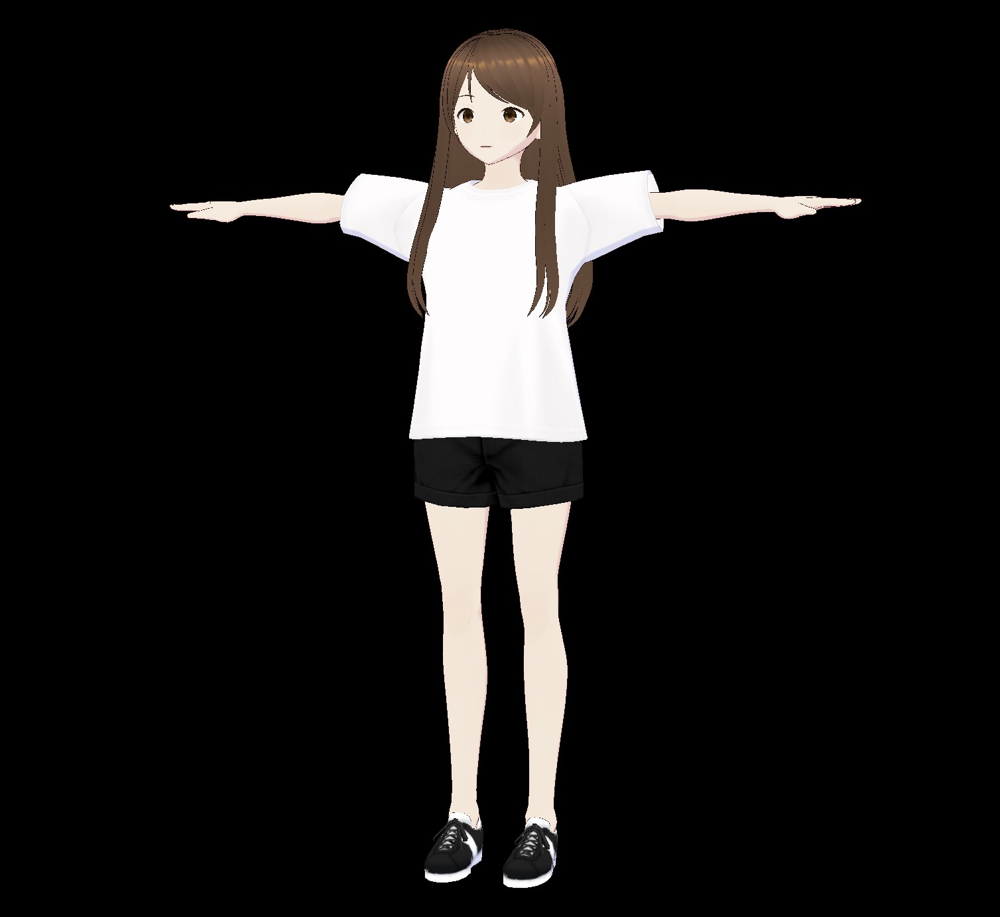
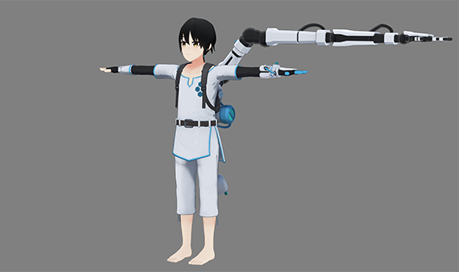
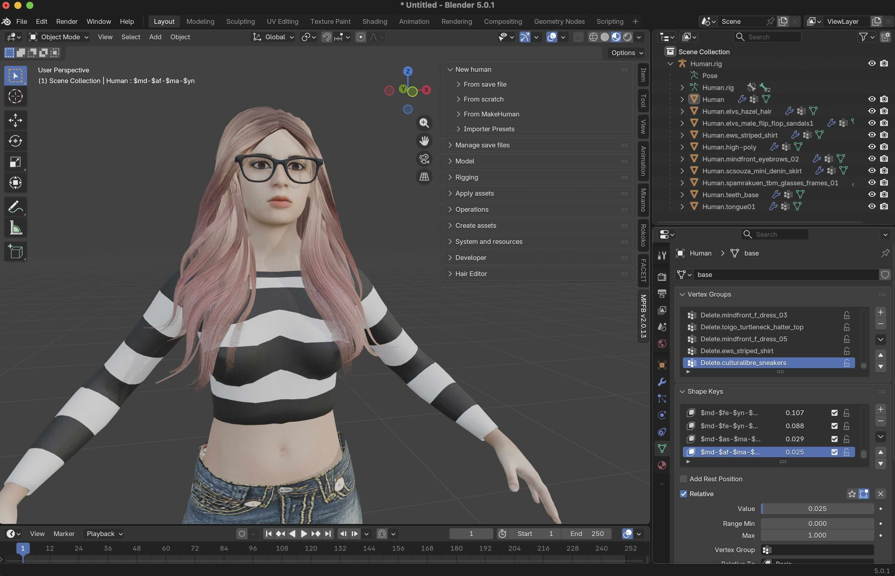

# Downloaded model catalog

Five original upstream runtime packages, acquired 13 October 2026. [manifest.json](manifest.json) records the pinned revisions, source URLs, sizes, and hashes of every upstream file. [inspection.json](inspection.json) contains extracted metadata. Package sizes include supporting files and upstream previews; triangle counts sum all triangle-mode mesh primitives and are not measured draw costs.

## 1. Constraint Twist — recommended first 3D persona

- **Entry point:** [VRM1_Constraint_Twist_Sample.vrm](models/vrm/constraint-twist/vrm/VRM1_Constraint_Twist_Sample.vrm).
- **Author:** pixiv Inc., copyright 2022. [Pinned official source](https://github.com/vrm-c/vrm-specification/tree/94e82dd346fa6cf0337c4421728640e5252dd38e/samples/VRM1_Constraint_Twist_Sample).
- **Appearance:** stylized female human, brown hair, casual white shirt/shorts. Screenshot shows the asset's reference pose; an idle pose is a separate integration step.
- **Local package:** 3 files, 10.36 MiB. Model alone: 10,776,032 bytes; 36,470 triangles across mesh primitives; 19 embedded images.
- **Face:** 57 named morph targets on the face mesh; VRM vowel presets `aa`, `ih`, `ou`, `ee`, `oh`, blink presets and emotional expressions. Use the expression manager to respect bindings and overrides.
- **License settings:** VRM Public License 1.0; `avatarPermission=everyone`, `commercialUsage=corporation`, redistribution allowed, modification/modified redistribution allowed; credit not required by the embedded setting. Antisocial/hate use is disallowed. See [the full extracted settings](inspection.json) and [license notes](licenses/README.md).
- **Why selected:** direct VRM loading, a clear human appearance, and useful standard expressions without a custom rig conversion.

## 2. Seed-san — second 3D persona

- **Entry point:** [Seed-san.vrm](models/vrm/seed-san/vrm/Seed-san.vrm).
- **Author:** VirtualCast, Inc. [Pinned official source](https://github.com/vrm-c/vrm-specification/tree/94e82dd346fa6cf0337c4421728640e5252dd38e/samples/Seed-san).
- **Appearance:** stylized short-haired human in a white/blue technical outfit. The upstream screenshot demonstrates a constraint test; it is not a prepared speaking pose.
- **Local package:** 3 files, 10.46 MiB. Model alone: 10,917,800 bytes; 45,058 triangles; 15 embedded images.
- **Face:** 43 named head morph targets, including vowel shapes; the same five named vowel presets plus blink, gaze and emotion presets.
- **License settings:** VRM Public License 1.0; everyone may use it as an avatar, corporate commercial use and redistribution are allowed, modification/modified redistribution allowed. **Credit is required:** retain “Seed-san model by VirtualCast, Inc.” with the source and license links.
- **Why selected:** a distinct second identity and a useful check that animation uses VRM semantics rather than one model's raw morph names.

## 3. Haru — recommended first Live2D persona

- **Entry point:** [Haru.model3.json](models/live2d/haru/Haru.model3.json). Load this file, keeping the folder structure intact.
- **Author:** Live2D Inc. [Official character page](https://www.live2d.com/en/learn/sample/haru/); [pinned runtime source](https://github.com/Live2D/CubismWebSamples/tree/b1de66b0b1f1cb881d95fb6158622aeb6a2827bd/Samples/Resources/Haru).
- **Appearance:** illustrated female character. The character page provides a rendered preview; the downloaded PNGs are packed texture atlases, not portrait previews.
- **Local package:** 47 files, 4.08 MiB; compiled `.moc3`, two texture atlases, physics, pose, parameter display info, expressions, motions, and original sample sound files.
- **Face:** declared `LipSync` group targets `ParamMouthOpenY`; `ParamMouthForm` appears in display info. Eye/blink and eyebrow controls are also declared. Eight expression files; six motion references in the model settings, with 27 motion files present in the upstream folder.
- **Limit:** these mouth controls offer opening/form deformation rather than a full consonant/vowel inventory. The display metadata was inspected; Cubism Core execution was not tested.
- **License:** Live2D Free Material License and Sample Data Terms. Required attribution is provided in [licenses/README.md](licenses/README.md); Cubism SDK release terms are separate.
- **Use:** illustrated alternative for the same outgoing TTS WAV. Keep bundled voices out of the assistant playback path; local acquisition does not establish permission to redistribute sample sound recordings.

## 4. Ren Foster — second Live2D persona

- **Entry point:** [Ren.model3.json](models/live2d/ren/Ren.model3.json).
- **Author:** Live2D Inc. [Official character page](https://www.live2d.com/en/learn/sample/ren-foster/); [pinned runtime source](https://github.com/Live2D/CubismWebSamples/tree/b1de66b0b1f1cb881d95fb6158622aeb6a2827bd/Samples/Resources/Ren).
- **Appearance:** illustrated male character; see the official page for a rendered preview.
- **Local package:** 13 files, 2.41 MiB; compiled model, one texture atlas, physics, display info, five expressions, and three motion files/references.
- **Face:** declared lip-sync target `ParamMouthOpenY`, with `ParamMouthForm`, blink, gaze and eyebrow parameters in display info.
- **License:** same Live2D agreements as Haru. Use the current official original-character terms and required attribution.
- **Use:** a second illustrated identity using the same Cubism adapter. Smaller download size does not establish faster animation; benchmark both.

Neither Live2D package includes Cubism Core, the Web SDK framework, editable `.cmo3` source projects, or a trained audio-to-viseme model. Obtain the runtime from [Live2D's official Web SDK distribution](https://www.live2d.com/en/sdk/download/web/) when implementing the renderer.

## 5. MPFB human — extra detailed face comparison

- **Entry point:** [mpfb.glb](models/glb/mpfb-human/mpfb.glb).
- **Author/provenance:** met4citizen's TalkingHead example, created with Blender and MPFB. [Pinned model source](https://github.com/met4citizen/TalkingHead/blob/2afe6d79779313db8909badebf46f9805a6c7b70/avatars/mpfb.glb); the preserved [upstream README](licenses/talkinghead-upstream-README.md) explicitly assigns **CC0 to this model**.
- **Appearance:** conventional human character; the upstream authoring screenshot depicts a glasses-wearing woman. The screenshot illustrates the creation workflow and does not verify the final GLB's appearance in this project.
- **Local package:** 2 files, 35.36 MiB. Model alone: 36,815,920 bytes; 83,686 triangles; seven embedded images.
- **Face:** base mesh has 66 named targets: 52 ARKit-style facial controls and 14 explicit Oculus-style speech visemes. Other meshes provide related eye, eyelash, eyebrow, teeth and tongue deformation. `jawOpen`, `mouthClose`, blinking, lip rounding and `viseme_PP` are present.
- **Important detail:** `viseme_sil` is not an explicit base target. Silence should release the speech morphs; do not assume all 15 viseme names exist on every mesh.
- **License:** model CC0; TalkingHead code is MIT. The provenance screenshot and repository license are preserved separately. Do not generalize this model's CC0 license to other sample GLBs in that repository.
- **Use:** compare richer mouth deformation or test TalkingHead with externally generated audio. It is an additional option, not the default stylized persona.

## What the checks establish

All five packages contain actual model bytes, rather than HTML download pages or Git LFS pointers. The three 3D files embed their image/buffer resources. Both Live2D entry points resolve all declared local dependencies. Checksums preserve the originally downloaded packages.

These checks do not establish visual correctness, full glTF conformance, frame rate, language quality, or accurate lip-sync. Render each in the intended runtime and exercise mouth/blink/emotion controls before choosing a final persona. The sample assets are suitable for a concrete evaluation; a final branded assistant may benefit from an original commission or VRoid/MPFB creation.
